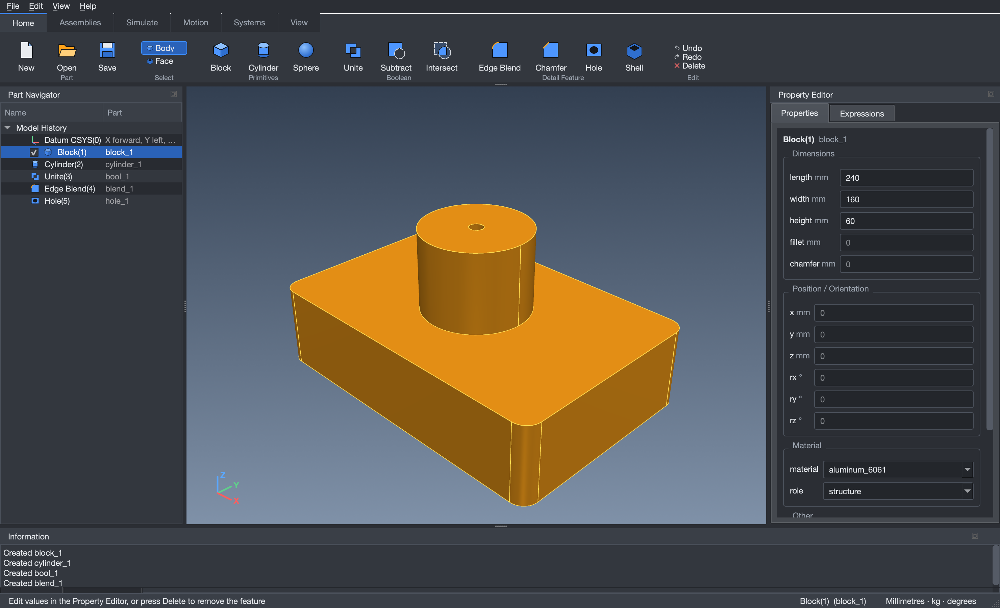
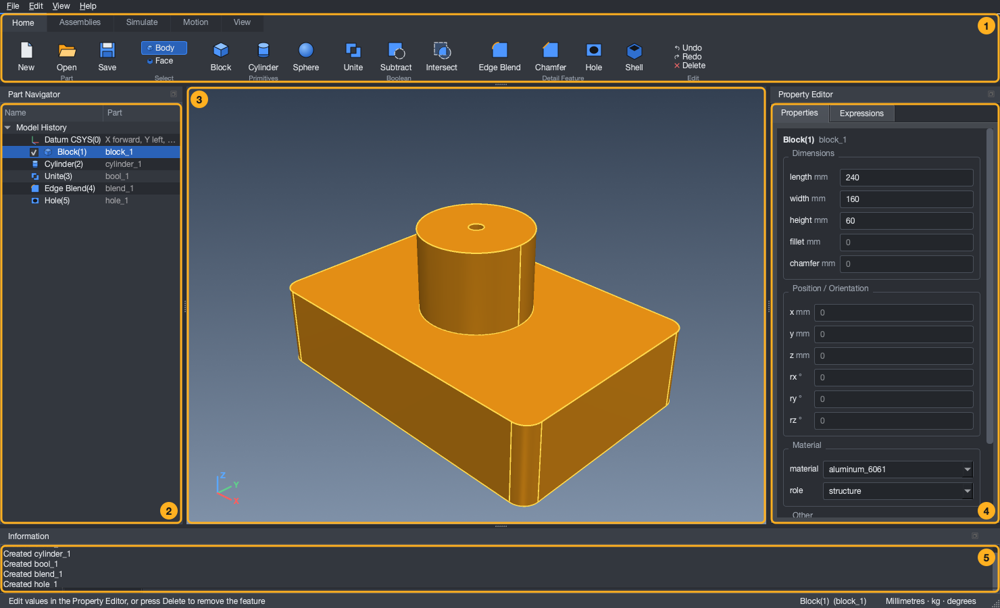
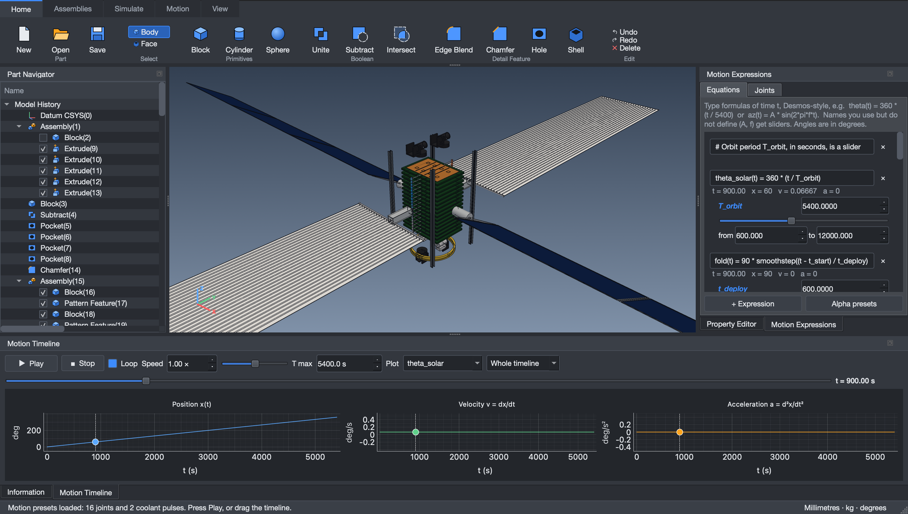
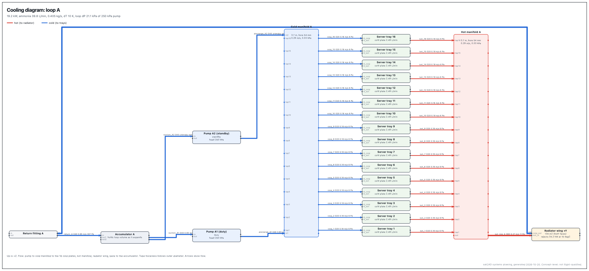
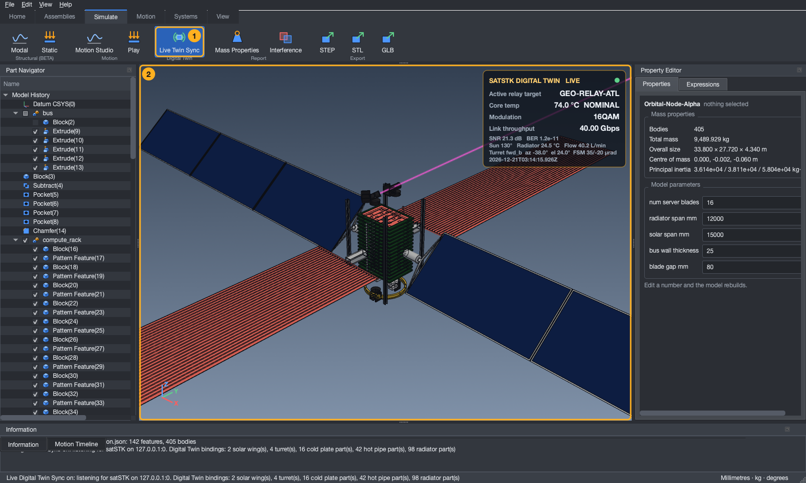
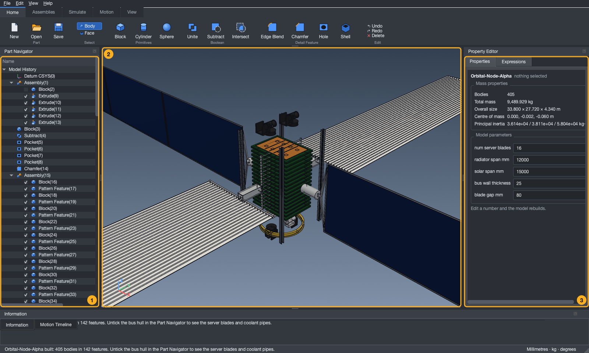
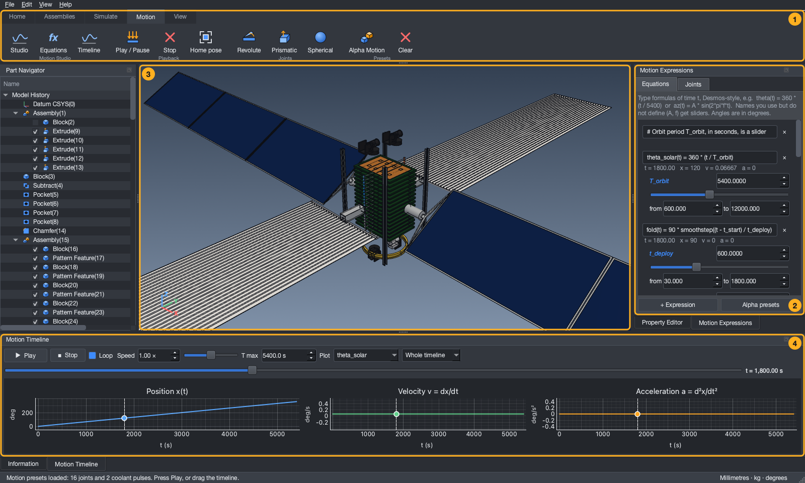

# SatCAD: open-source spacecraft CAD you can talk to

SatCAD lets you describe a spacecraft in plain English and have **Claude** build it as a real 3D model,
draw it, weigh it (including its full **inertia tensor**), check it for mistakes, show it in an interactive 3D viewer,
run a first-order **vibration and stress analysis** on it, and export it as a CAD file. Every dimension can be a named variable or a formula, so changing one number rebuilds the
whole design. You do not need any CAD experience. It can also be used as an ordinary Python library, or through ready-made
example scripts.



*The satCAD desktop app: ribbon across the top, the feature tree on the left, the 3D view in the middle and the editable settings of the selected part on the right.*

SatCAD is built on **[build123d](https://github.com/gumyr/build123d)** (a free, open-source CAD library on the
OpenCascade geometry kernel) and talks to Claude through the **Model Context Protocol (MCP)**. It was written
for an orbital AI datacentre project ([Orbital-Datacentre](https://github.com/Saiaarjay09/Orbital-Datacentre))
but works for any simple spacecraft or box-and-panel design. It is an independent project: it is not derived
from, and not affiliated with, Siemens NX. Files it exports (STEP) are a standard format that NX can import.

> **How capable is it, honestly?** SatCAD is a **concept-design and trade-study tool** with an exact solid-modelling
> kernel, parametric feature history, formulas, real mass properties, and verified physics for what it computes. It is **not** a
> replacement for professional CAD plus certified structural, thermal and orbital analysis, and it should not be the sole basis
> for flight hardware. What it does and does not cover, measured line by line against Siemens NX's publicly described
> capabilities, is in **[docs/NX_BENCHMARK.md](docs/NX_BENCHMARK.md)**; the plan to close the gap is in
> **[docs/ROADMAP.md](docs/ROADMAP.md)**.

## Quick start: SatCAD Studio (the app)

Prefer a window to a command line? **SatCAD Studio** is an app for Mac and Windows: open it, add parts and variables, see the
design in 3D, check it, run the vibration / stress analysis, and **open an existing design (`.json`) to improve it**. Download it from
the **[Releases](https://github.com/Saiaarjay09/Open-source-CAD-software/releases)** page: a `.dmg` for Apple-silicon Macs, a
`-setup.exe` installer for Windows. It runs on your own computer only. The apps are not code-signed, so the first launch shows a
warning; [docs/RELEASE_NOTES.md](docs/RELEASE_NOTES.md) explains the two clicks needed. To run Studio from source instead:
`.venv/bin/python -m satcad.studio`. How releases are built: see [section 13](#13-building-and-publishing-the-studio-app).

---

## New to CAD? Start here: moving around and what every button does

You do not need any CAD experience. A CAD program makes **solid 3D objects out of numbers**: you add simple shapes (a block, a cylinder), type their sizes, and combine or reshape them.
Nothing you do here can break anything: **Ctrl+Z undoes** (Ctrl+Y redoes), and anything satCAD cannot do it explains in the Information window at the bottom instead of changing your part.
All lengths are in **millimetres**, angles in **degrees**. **X** points right, **Y** points away from you, **Z** points up.

### A. Moving the view (looking around your model)

Moving the *view* never changes your part. It is like walking around a statue.

| You want to | With a mouse that has a middle button | On a Mac trackpad (no middle button) |
|---|---|---|
| **Rotate** (look from another side) | hold the **middle button** and drag | hold **Option (Alt)** and drag with one finger |
| **Pan** (slide the model sideways) | hold **Shift** + the middle button and drag | hold **Option + Shift** and drag |
| **Zoom** | roll the **wheel**, or hold the **right button** and drag (down zooms in, up zooms out) | **two-finger scroll** up / down |
| **Select** a body | **left click** it (it turns orange) | tap / click it |
| Click empty space | selects nothing | same |
| Context menu (delete, standard views) | **right click** | two-finger click |

Quick keys: **F** zooms to fit the whole model, **Home** gives the corner (isometric) view. The **View** tab has buttons for **Top**, **Front**, **Right**, **Left**, **Isometric** and **Fit**,
and for how the model is drawn: **Shaded + Edges** (default), **Shaded**, or **Wireframe** (see-through lines). Lost? Press **F**, then **Home**.
The little X / Y / Z arrows in the corner of the 3D view always show which way you are looking. You cannot turn the model upside down by accident: rotating stops at straight up and straight down.

### B. Moving the part itself (changing where it sits)

This is different from moving the view. Click the part, then look at the **Property Editor** on the right. Type a new number and press **Enter**:

| Box | What it does |
|---|---|
| `x`, `y`, `z` | where the part sits, in mm (for a block, cylinder or sphere this is its **centre**) |
| `rx`, `ry`, `rz` | how much it is turned about each axis, in degrees |
| `length`, `width`, `height` (or `radius`) | its size |

satCAD is **number-driven**, so there is no drag-the-part-with-the-mouse handle yet: you type where things go. That is deliberate. A typed number is exact, repeatable, and can be a
formula (type `=` first, e.g. `=wing * 2`, with `wing` defined on the **Expressions** tab), so changing one number can resize and move many parts at once.

### C. What each button does

**Home tab**

| Button | What it does | When you would use it |
|---|---|---|
| **New / Open / Save** | start a fresh part, open a saved `.json` design, save yours (Ctrl+N / O / S). Saves go in the `sattelite designs` folder | always |
| **Body / Face** (Select) | **Body**: clicking picks a whole body. **Face**: clicking picks one flat surface, and **Hole**, **Shell** and **Edge Blend** then start from it | use Face when you want a hole exactly where you click |
| **Block, Cylinder, Sphere** | add a 100 mm block, a cylinder (radius 30, height 100) or a sphere (radius 50) | the starting shapes for everything |
| **Unite** | glue two bodies into one (they must touch or overlap) | build a bracket from two blocks |
| **Subtract** | cut the **tool** body out of the **target** body; the tool disappears | drill a big hole or notch with a cylinder |
| **Intersect** | keep only the volume both bodies share | trim one shape with another |
| **Edge Blend** | round off edges with a radius (mm) | remove sharp corners, as on a real machined part |
| **Chamfer** | bevel edges with a distance (mm), a flat 45-degree cut instead of a curve | the same, for a sharper look |
| **Hole** | an ISO-standard hole (M3 to M12): *clearance* (a bolt passes through), *tapped* (a bolt screws in), *counterbore* or *countersink* (the bolt head sits flush). Depth 0 = all the way through | bolt holes |
| **Shell** | hollow a solid out to a wall thickness, leaving the faces you list open (e.g. `+z`) | turn a solid box into an open box |
| **Undo / Redo / Delete** | step back / forward, or remove the selected feature | when you want to try something |

In the **Edge Blend / Chamfer** dialog the **Edges** choice means: `all` every edge; `parallel:z` the edges running along Z; `face:+z` the edges around the top face.
The face names `+x -x +y -y +z -z` are the right, left, back, front, top and bottom of the part.

**Assemblies tab**

| Button | What it does |
|---|---|
| **New Assembly** | a named group of parts. Give it a hinge axis and angle and the whole group swings about a pivot (a solar wing opening, say) |
| **Interference** | checks whether any bodies overlap, or float away from everything else, and lists them |
| **Mass Properties** | total mass, centre of mass and the inertia of the whole model (each part has a material; the default is aluminium 6061) |

**Simulate tab**: **Modal** (how the structure vibrates, shown as an animated picture in your browser) and **Static** (stress and sag under a load such as 6 g) are early-stage **BETA** estimates, not a substitute for
professional analysis; **Motion Studio / Play** make parts move from equations (see the guide); **STEP / STL / GLB** export your design: STEP for other CAD programs, STL for 3D printing, GLB for web and AR viewers.

**View tab**: the standard views and display modes above, plus **X-Ray** and **Show All** (see the heavy orbital node section).

### D. Your first ten minutes: a bolted bracket

Follow this and you will have used most of the buttons. Every step can be undone.

1. **Block**. In the Property Editor set `length` 100, `width` 60, `height` 10 (a flat plate). Press **F** to fit the view.
2. **Cylinder**. Set `radius` 8, `height` 30, and `x` 30. It is a rod poking through the plate.
3. **Subtract**: Target body = the block, Tool body = the cylinder. The rod is gone and left a hole.
4. **Edge Blend**: Body = the block, Edges = `all`, Radius = 3. The corners are rounded.
5. Switch **Select** to **Face**, click the top face of the plate beside the hole, click **Hole**, keep M6 clearance and depth 0 (through). A bolt hole appears where you clicked.
6. Rotate with the middle button (or **Option + drag**) to admire it, then **Mass Properties** to see its weight, and **Save**.
7. Now fiddle: click the block and change `length` to `150`: everything rebuilds. Try a formula: add a variable `plate` = `100` on the Expressions tab, set the block `length` to `=plate`, then change `plate`.

The **Part Navigator** (left) lists what you did in order (`Block(1)`, `Cylinder(2)`, `Subtract(3)` ...). Click a row to select that step; the tick box hides or shows a body; right click a row to delete it.
For screenshots of every area, see the [illustrated guide](docs/HOW_TO_USE.md).

---

## The desktop application (Qt + VTK)

A full desktop window in the layout of a professional CAD package: **ribbon** across the top (Home, Assemblies, Simulate, View), **Part Navigator**
feature tree on the left (Datum CSYS(0), Block(1), Cylinder(2), Unite(3), Edge Blend(4) ...), **Property Editor** on the right (the parametric
dimensions of whatever is selected, plus an Expressions tab), a shaded **3D viewport** with edge highlights in the centre, and an Information window
for messages and results. Dark theme throughout. It is NX-*inspired* (layout and workflow); it uses none of Siemens' artwork or code.



**Download it:** the **Releases** page has a `.dmg` for Apple-silicon Macs and a `-setup.exe` installer for Windows (unsigned, so the first launch shows a warning; the release notes explain the two clicks). **Or run it from source** (Python 3.10 or newer; the graphics libraries are large, roughly 400 MB):

```bash
pip install -r requirements.txt          # CAD kernel (build123d / OpenCASCADE) and the engine
pip install PySide6 vtk                  # the interface (Qt for Python) and the 3D renderer (VTK)   [same as requirements-gui.txt]
python main.py --demo                    # or:  python -m satcad.gui  [saved_part.json]
```

**What you can do:** click a body to select it (or switch the **Select** filter on the Home tab to **Face** and click a flat face: **Hole**, **Shell** and **Edge Blend** then start from that face, and a hole is placed exactly where you clicked); edit any dimension in the Property Editor (numbers or `=formulas`) and the part rebuilds; create
Blocks, Cylinders and Spheres; **Unite / Subtract / Intersect** two bodies (the tool body is consumed, as in NX); **Edge Blend**, **Chamfer**, **Hole**
(ISO sizes) and **Shell**; group parts into **assemblies** with hinges; run **Interference** and **Mass Properties**; run the BETA **modal / static**
structural analysis; **undo / redo** every change; open and save parts (`.json`, the same files Claude and the Studio app use); export **STEP / STL / GLB**.

**Mouse:** left click selects, **middle drag rotates**, **Shift + middle drag pans**, wheel or two-finger scroll zooms, right drag zooms, right click opens a
menu. With no middle button (Mac trackpad): **Alt + left drag rotates, Alt + Shift + left drag pans**. Keys: Ctrl+Z / Ctrl+Y, Delete, F (fit), Home (isometric).

**How the geometry kernel and the 3D viewport are connected**

1. **Kernel.** Parts are exact B-rep solids in **OpenCASCADE**, accessed through build123d's `cadquery-ocp` bindings. We stay on that binding rather than
   PythonOCC, because PythonOCC is a separate set of OpenCASCADE wrappers (mostly conda-installed) whose shape objects cannot be mixed with the ones the engine
   already builds, so adopting it would mean rewriting the whole engine for no gain.
2. **Tessellation.** `viewport.part_polydata()` asks OpenCASCADE to triangulate each solid and packs the triangles into a `vtkPolyData`; a `vtkPolyDataNormals`
   filter computes smooth normals that split at sharp edges, so cylinders shade smoothly while box faces stay flat.
3. **Edges.** `viewport.part_edges()` samples the solid's real B-rep edges into polylines drawn in dark lines over the shaded surface: the "shaded with edges" look.
4. **Rendering.** Each body is two VTK actors (surface, edges) in one `vtkRenderer` with Phong shading, a three-point light kit and polygon offset (so edges never
   flicker against surfaces). VTK renders into an **off-screen** window; the frame is read back, supersampled 2x for smooth edges, and painted by an ordinary Qt widget.
   (The stock VTK-in-Qt widget embeds a native GL surface; it hangs on some recent macOS releases, and the off-screen route behaves identically on macOS, Windows and Linux.)
5. **Interaction.** Mouse events are translated into camera moves (a turntable orbit that keeps Z up, pan, dolly) in `viewport.py`; picking uses VTK's `vtkPropPicker` for bodies
   and `vtkCellPicker` for faces (each triangle carries the id of its B-rep face), and a click selects the matching feature in the Part Navigator. Selection, visibility checkboxes and the tree stay in sync through Qt signals on a single `Session`
   object that wraps the engine and keeps undo history.

The Claude connector and the browser-based Studio keep their own lightweight renderers (matplotlib pictures and three.js), because they must work without a graphics
stack; the desktop application does not use them.

---

## Motion Studio: equations, joints and a timeline

**Motion** tab on the ribbon. It combines a Desmos-style equation list with NX-Motion-style kinematic joints: type formulas of time, bind them to
the assemblies of your model, and scrub or play the result in 3D with live plots next to it. The kinematics are rigid-body (positions, velocities,
accelerations): there is no dynamics, no contact and no collision test while a mechanism moves.



*Orbital-Node-Alpha at t = 900 s with the bus hull hidden: solar wings turned 60 degrees by `theta_solar(t)`, radiators fully deployed, equations and plots on the right and below.*

**Writing motion formulas.** Open **Motion > Equations**. One formula per line; time is `t` in seconds, angles are in **degrees** (but `sin`, `cos`
take radians, exactly as in Desmos, so write `sin(2*pi*f*t)`), lengths in mm.

```text
theta_solar(t) = 360 * (t / 5400)                    a function of time: x(t)
az_laser(t)    = A * sin(2 * pi * f * t)             A and f are never defined: sliders appear under the equation
omega          = 2 * pi * 0.5                        a constant (no "(t)"): usable in the other formulas
fold(t)        = 90 * smoothstep((t - 60) / 600)     an S-curve from 0 to 90 degrees between t = 60 s and 660 s
coolant(t, k)  = 0.5 + 0.5 * sin(2*pi*(0.4*t - k/24))   a second argument k (a row index) for travelling waves
```

- **Auto sliders.** Any name you use but never define becomes a slider right under the equation (set its value exactly, or drag; the two end boxes
  are editable and widen if you type outside them). Dragging re-poses the model immediately: no re-parsing, no re-meshing.
- **Velocity and acceleration** come for free: SymPy differentiates your formula exactly, so the plots show x(t), v = dx/dt and a = d2x/dt2 for any function.
  The status line under each equation shows the three values at the current time.
- **Functions you can use:** `sin cos tan asin acos atan atan2 sinh cosh tanh exp log ln sqrt abs sign floor ceil mod min max`, the degree versions
  `sind cosd tand`, the shapers `sigmoid(x)`, `smoothstep(x)` (0 below 0, 1 above 1, S-curve between), `smootherstep(x)`, `clamp(x, lo, hi)`, `step(x)`,
  and the constants `pi` and `e`. Use `^` or `**` for powers and `*` for every multiplication. Formulas may refer to each other in any order; circular
  definitions and typos are reported on the line they occur and never stop the other lines.
- Formulas are parsed by SymPy in a restricted namespace (no attribute access, no double underscores, nothing but the functions above), then compiled to
  NumPy (`lambdify`), about 2 microseconds per evaluation. (NumExpr is not used: compiled NumPy is already far below a frame's budget.)

**Joints.** A joint moves one *assembly* (and every part and sub-assembly inside it) rigidly. Select an assembly in the Part Navigator, open
**Motion > Joints** (or the ribbon's Revolute / Prismatic / Spherical buttons) and choose the driving equation. Axis and pivot are given in the model's
home (drawn) pose, in mm.

| Type | Degrees of freedom | Typical use |
|---|---|---|
| **Revolute** | one rotation about an axis through a pivot, driven by one equation (degrees) | hinges, solar-array drives, deployment |
| **Prismatic** | one translation along an axis, driven by one equation (mm) | slides, boom extension |
| **Spherical** | two rotations at a pivot: first about axis 1, then axis 2, each driven by its own equation | gimbals, mirror tip / tilt |

Joints nest: an assembly inside a moving assembly is carried by it (an elevation stage rides on its azimuth stage), and the solver composes them
automatically. An *offset* shifts the driven value (for example -90 when the model is drawn deployed and 0 should mean stowed); optional minimum and
maximum clamp the travel. Each assembly can have one joint.

**Timeline (bottom dock).** Play / Pause / Stop, Loop, speed from 0.1x to 10x, a time scrubber over [0, T max], and three synchronised plots of the
selected function (position, velocity, acceleration) with a cursor that follows the current time and **can be dragged to scrub the 3D view**. Plot windows
(whole timeline, +-300 s ... +-2 s around the cursor) let you zoom into fast oscillations.

**How it stays smooth.** The solver only produces 4x4 matrices; the viewport applies them to the *existing* mesh actors (one shared matrix per joint),
so nothing is re-tessellated while a mechanism moves, and while playing the viewport renders without supersampling. On the full Orbital-Node-Alpha model
(405 bodies, 16 joints, 2 coolant-pulse colour animations) at 1480 x 900 the development Mac sustained about 61 frames per second with the docks open.
(The rendering is VTK's with `GetPixelData` read-back; "SetLocation on an AIS context" is the OpenCASCADE-viewer equivalent of this, which satCAD does not use.)

**The Orbital-Node-Alpha example** (open `sattelite designs/orbital_node_alpha_with_motion.json`; nothing is built into the app): four mechanisms written as plain equations you can edit.

| Mechanism | Joint(s) | Equation (defaults are sliders) |
|---|---|---|
| Solar-array sun tracking `SADA_Revolute` | revolute about X, both wings | `theta_solar(t) = 360 * (t / T_orbit)`, T_orbit = 5400 s: one full turn per orbit |
| Radiator wing deployment `Radiator_Fold_Hinge` | revolute about X at each wing root, offset -90 | `fold(t) = 90 * smoothstep((t - t_start) / t_deploy)`: 0 = stowed along -Z, 90 = deployed |
| OISL turret PAT tracking `Turret_Gimbal` | per turret: azimuth (revolute, Z), elevation (revolute, X, riding on the azimuth stage), and a spherical fast steering mirror | `az_laser`, `el_laser` sinusoids; `fsm_tip/tilt = -k_fsm * (gimbal error) + A_jit * jitter`, a loop that partly cancels the gimbal motion |
| Coolant flow pulse | colour wave along the 24 segments of the hot and cold manifolds | `coolant(t, k) = 0.5 + 0.5 * sin(2*pi*(f_flow*t - k/n_seg))`: a phase shift per segment |

Motion setups are saved inside the part's `.json` (under `"motion"`) and restored when you open it. Joint axes and pivots in the presets are read from the
model's own geometry, so they follow it when you change its parameters.

> **Where the example designs are.** The finished example designs (`.json` and `.step` files) are no longer stored in this public repository; they live in a private one. The app still
> uses the folder name `sattelite designs` (it is created on first save, and git ignores it here). You can rebuild the two public examples yourself with
> `python generate_orbital_node_assembly.py --json alpha.json` and `python generate_heavy_orbital_node.py --diagrams`, then **Home -> Open** the result.

## The Orbital-Node-Alpha assembly

`generate_orbital_node_assembly.py` builds the detailed AI-datacentre satellite: six named sub-assemblies, 405 bodies, 9.5 t, no overlaps. The app does **not** include it: satCAD starts empty and
you make what you want or import a design. To use this one, **Open** `sattelite designs/orbital_node_alpha.json` (or `orbital_node_alpha_with_motion.json`, which also carries its Motion Studio setup), then untick the bus hull in the Part Navigator
to see the blades and coolant pipes. To make a variant, run the script:

```bash
python generate_orbital_node_assembly.py --step alpha.step --json alpha.json --set NUM_SERVER_BLADES=12
```

Coordinates: origin at the centre of the bus; **Z** is the velocity vector (fore / aft), **Y** the anti-Sun axis (radiator wings), **X** the Sun-facing axis (solar wings).

| Sub-assembly | Contents |
|---|---|
| `bus` | 2000 x 2000 x 3500 mm hull hollowed by a Boolean subtract (25 mm wall), inspection windows on +/-X, pipe ports, four I-beams, gold launch-adapter ring (OD 1575, ID 1450, 150 high, 5 mm bottom chamfer) |
| `compute_rack` | 16 blades (1600 x 1200 x 60, 80 mm gaps) each with 8 silicon packages and a grooved copper cold plate |
| `mpfl` | two pumps with mounting saddles, hot (+Y) and cold (-Y) manifolds in 24 segments, 10 mm feeder tubes to every plate, 3-way bypass valve with bypass pipes |
| `radiators` | two wings (3000 x 12000 x 12) on 800 mm truss booms, root manifolds, 24 micro-tubes on each face, feed lines through the bus wall |
| `solar_arrays` | SADA cylinders, Y-shaped yokes, three framed solar segments per side with 20 mm hinge gaps (15 m total span) |
| `oisl_turrets` | four terminals (2 forward, 2 aft): azimuth base, U-yoke, hollow telescope barrel (OD 220, ID 190, 350 long), 45-degree fast steering mirror, lens, trunnion pins |

Colours follow the specification (gold ring, dark-green PCBs, copper cold plates, steel pipes, white radiators, deep-blue solar cells, black turrets,
cyan lenses) and are written into the **STEP** file by the export (AP214, `COLOUR_RGB`; every body is a named product, but the sub-assembly nesting is flattened into one list). The four headline numbers are model variables, shown in the Property Editor when
nothing is selected: `NUM_SERVER_BLADES` (1 to 18), `RADIATOR_SPAN_MM`, `SOLAR_SPAN_MM`, `BUS_WALL_THICKNESS` (5 to 60 mm); change one and the assembly rebuilds
(under a second after the first build). Two details of the brief were interpreted: "80 mm vertical spacing" for blades 60 mm thick is taken as an 80 mm *gap*
(140 mm pitch, so 16 blades span +/-1080 mm of the +/-1200 mm range); and the stowed radiator position is along -Z (the launch axis), unfolding to +/-Y.

---

## The heavy orbital node and X-Ray

`generate_heavy_orbital_node.py` is a second, larger example (a standalone script; the app does not include it either): a 3.5 x 3.5 x 5.5 m hollow bus with **16 server trays** (2200 x 1800 x 65 mm,
220 mm pitch), three colour-coded schematic systems (`HV_Power_Schematic` orange, `Optical_Data_Schematic` cyan, `MPFL_Fluid_Schematic` red / blue) routed through the corridors beside the trays,
four laser turrets, and two 16 m radiator wings with trapezoidal ridges and rifled micro-ridge tubes: **320 bodies in the geometry (343 with the routed cables and pipes), about 19 t, no overlaps, geometry rebuilt in about 0.2 s**. **Open**
`sattelite designs/heavy_orbital_node.json`, then use **View -> X-Ray** to make the hull, racks and radiator skins 85% transparent while the power, optical and fluid loops stay solid.
Parts get an X-Ray group from their `layer` setting; each Part Navigator assembly row has a tick box that hides or shows all its parts. `BUS WIDTH MM`, `TRAY PITCH MM` and
`FIN RIDGE ANGLE DEG` appear in the Property Editor and rebuild the model when changed. See [section 6b of the guide](docs/HOW_TO_USE.md#6b-the-heavy-orbital-node-and-x-ray).

```bash
python generate_heavy_orbital_node.py --set TRAY_PITCH_MM=200 --name my_node
```

Honest limits: the 35 mm wall is a plain solid wall (no isogrid pattern), the 650 mm corridor is measured from the outer skin (615 mm clear inside along X), and the pipes, pumps and
electronics are schematic shapes for layout and clash checking, not analysed or flight hardware.

## Wiring, cooling and optical systems (and the 3D internals)

A satellite's guts are not just boxes: they are cables, coolant tubes and fibres. satCAD keeps a **netlist** inside the design file (what connects to what, and what each run is
made of), tied to parts of the 3D model. From it satCAD routes the runs, draws them as real tubes in the model, checks them, and draws the diagrams.



| You get | How |
|---|---|
| **Wiring diagram** of the 48 V network: sources, busbar with every tap, every cable and bar with gauge, current and voltage drop | **Systems -> Wiring** |
| **Cooling diagram** of each coolant loop: pumps, accumulator, manifolds, 16 cold plates, radiator, flow arrows, speed and pressure drop on every tube, pump and radiator budget | **Systems -> Cooling** |
| **Optical diagram**: turrets, EDFAs, core switches, the fibre backbone, loss and latency per run and per path | **Systems -> Optical** |
| **3D routing view**: every cable, tube and fibre in 3D in your browser (drag to rotate, wheel to zoom, hover a run for its numbers, no internet needed) | **Systems -> 3D Routing** |
| **Rule checks**: current density, voltage drop, source capacity, flow speed, pump head, radiator capacity, fibre bend radius and loss budget, clearance between electrical and coolant runs, exact-geometry clashes, routes made stale by a design change | **Systems -> Check** |
| **One-click update** after you change the model: ports follow their parts, automatic runs re-route, tubes redraw | **Systems -> Update** |
| **Cut lists** (wires, tubes, fibres) as CSV, plus all the drawings, in the designs folder | **Systems -> Schedules** |
| **One network at a time in 3D**: Power / Optical / Cooling / Shell toggles (and View -> X-Ray) | **Systems -> Show** |

Open `sattelite designs/heavy_orbital_node.json` to try it (the app does not include it; it is an ordinary design file). It carries a 48 V busbar with taps and cables, the optical
backbone, and two redundant ammonia loops with pump skids: **188 runs, 343 bodies, 0 clashes, 0 rule errors**. The pre-made drawings are in
[`sattelite designs/heavy_orbital_node_systems`](sattelite%20designs/heavy_orbital_node_systems/) (open the `.html` files in a browser). From code:

```bash
python generate_heavy_orbital_node.py --diagrams          # build, check, save, and write the drawings
```

```python
from satcad import Design, diagrams, routing
from satcad.systems import Systems
d = Design("x"); d.load("sattelite designs/heavy_orbital_node.json")
S = Systems.of(d)
print(S.report(d))                          # numbers and findings
diagrams.write_all(S, d, "drawings")        # wiring / cooling / optical / 3D view / CSV cut lists
d.set_variable("TRAY_PITCH_MM", 200)        # change the model...
routing.update(d, S)                        # ...and re-route everything in one call
```

**How to build your own:** `Systems().component(...)` adds a box (a pump, a battery) with named ports anchored to model parts, `.link(...)` adds a cable, tube or fibre between two ports
(`auto=True` lets the router find the path), `.loop(...)` describes a coolant loop, and `.save_to(design)` stores it in the file. `generate_heavy_orbital_node.py` (function `netlist`) is a full example.

**Honest limits.** The loads, pump heads, fluid properties and current-density screen are assumptions for concept studies, written in the file and editable; this is not a
MIL-W-5088 / ECSS harness analysis, not flight-qualified, and it has no connector pin-outs, formboards, variants or parts library yet. How it compares with Siemens Capital, point by
point and without hype, is in [docs/CAPITAL_BENCHMARK.md](docs/CAPITAL_BENCHMARK.md).

## Cross-CAD parametric transpiler (solving the "dumb solid" STEP problem)

Open a STEP file in SolidWorks, Fusion or NX and you get a **dumb solid**: the geometry arrives, but the feature tree and the equations do not. satCAD keeps the recipe
(named variables, formulas and the feature history), so it can write that recipe out as a **script each program runs to rebuild the model with its own features and its own
equation list**. Scripts for **Siemens NX** (NXOpen journal), **Autodesk Fusion** (API script), **SolidWorks** (VBA macro) and **FreeCAD** (FCMacro) come from one shared
intermediate representation, so a variable you change here is a variable you can change there.

| Where | How |
|---|---|
| **In the app** | **Simulate -> Export -> CAD Script** (or **File -> Export Parametric Script (CAD Transpiler)...**). A window opens with one tab per program, a checklist of the parameters and features it found, a live, colour-highlighted preview of the script, **Copy to Clipboard**, **Save Native Script...** and **Export Bundle (.STEP + All 4 Parametric Scripts)...** |
| **From Python** | `from satcad import parametric_transpiler as tp` then `ir = tp.build_ir(design)` and `tp.export_nxopen_journal(ir)`, `tp.export_fusion_script(ir)`, `tp.export_solidworks_macro(ir)`, `tp.export_freecad_macro(ir)`, or `tp.export_bundle(design, "folder")` |
| **From the shell** | `python -m satcad.parametric_transpiler design.json --out scripts --bundle` |

**What you get in each program**

| Program | Equations | Features that stay tied to those equations | Written as numbers or notes |
|---|---|---|---|
| **Siemens NX** | every variable and formula as an expression (Tools -> Expressions, Ctrl+E) | block edge lengths, cylinder and sphere sizes, linear-pattern count and pitch, boolean features, **move distances and hinge angles** | sketch extrudes, revolves, circular patterns, mirrors, fillets and shells are listed in the script as comments |
| **Autodesk Fusion** | every variable and formula as a User Parameter (Modify -> Change Parameters, unitless so mixed formulas work) | box and cylinder sketch dimensions and extrude distances, rectangular-pattern quantity and spacing, combine (join / cut) | positions and rotations are evaluated when the script runs; spheres, sketch extrudes, revolves, mirrors and fillets are comments |
| **SolidWorks** | every variable and formula in the Equation Manager | box sketch dimensions and extrude depth bound by equations | everything else is described in comments for you to finish |
| **FreeCAD** | a `Params` spreadsheet with an alias per variable | box, cylinder and sphere sizes and (for unrotated bodies) positions, **Draft array count and pitch**, booleans, mirrors, cut tools for holes and cutouts | fillet sizes, rotations and placements through assemblies are numbers |

**What the transpiler can and cannot carry over.** Boxes, hollow chassis, cylinders, spheres, rectangle / circle / polygon extrudes, revolves, booleans, linear / circular /
grid patterns, mirrors, edge treatments, holes, cutouts and assembly placements (including hinge angles) are all read into the intermediate representation. Sweeps, lofts, screws,
tilted panels and imported STEP bodies are **reported as unsupported** (they are left out of the scripts; use the STEP file from the same bundle for those bodies). Each feature
is marked in the window and in the script header as **native** (every formula stays a formula), **evaluated** (some value became a number, for example a formula that reads another
part's size, or the position of a hole) or **unsupported**.

**Honest limits.**
- The **intermediate representation and the formula translation are tested** inside satCAD: the IR is rebuilt with build123d and compared body by body with satCAD's own rebuild,
  including after changing variables, and every formula is evaluated in each program's syntax and compared with satCAD's value. The generated scripts are also run against
  stand-in APIs (they parse, register every parameter and issue the expected calls).
- The calls into the **NX, Fusion and SolidWorks APIs have not been run against those programs** (there is no licence here). They are written from the public API shapes and will
  probably need a small adjustment for your version. Read a script and try it on a copy first. The FreeCAD macro has been run only against a stand-in, too.
- Only what is a **variable** in the design can be changed in the other program: a size written as a plain number stays a plain number. Motion Studio parameters (a
  deployment ratio, a sun angle) are not part of the feature history, so they are not exported; hinge angles that are variables or formulas in the design are.
- Holes and cutouts are placed from the target's size when you export, so they do not follow a later change of a variable.

## Live Digital Twin with satSTK (macOS)

satCAD can be the 3D "digital twin" of the satellite that **satSTK** (the orbital mission and laser-link simulator, [Saiaarjay09/satSTK](https://github.com/Saiaarjay09/satSTK)) is flying.
While satSTK runs an orbit it streams its live state, 30 times a second, to `127.0.0.1:9876`; satCAD listens on a background thread and, **without freezing the viewport**:

- turns the **+X and -X solar arrays** to the angle that points them at the Sun (`sun_vector_body_deg`);
- swivels the **azimuth and elevation stages of the active OISL laser turret** and draws a **glowing laser ray** out of the telescope barrel toward the locked target (a different colour for each relay);
- colours the **16 copper cold plates, the hot manifold pipes and the radiator panels** from the core temperature: cool blue at 30 degC, gold / white at 60, throttle crimson at 85;
- shows a translucent **heads-up display** in the top-right corner of the 3D view: active relay target, core temperature, modulation scheme and link throughput (plus SNR, BER, turret angles, Sun angle and a LIVE / STALE / WAITING light).



**Run both side by side with one command:**

```bash
./run_digital_twin.sh                    # starts satCAD in Digital Twin Listener Mode, then satSTK (in $SATSTK_HOME, default ~/Developer/STK)
SATSTK_HOME=$HOME/Developer/STK ./run_digital_twin.sh
./run_digital_twin.sh --demo             # no satSTK? stream made-up telemetry instead (tools/twin_demo_sender.py)
```

or by hand, in two Terminal windows (set up each once with its own `./setup.sh` / `./run.sh`):

```bash
# window 1: satCAD, listening
.venv/bin/python main.py --digital-twin                 # opens the Orbital-Node-Alpha example and switches Live Twin Sync on
# window 2: satSTK, broadcasting
cd ~/Developer/STK && ./run.sh --broadcast --autoplay --no-placement --speed 60     # satSTK plays an orbit at 60x; satCAD's HUD turns LIVE
# no window for satSTK?  ./run.sh --headless --broadcast --speed 60
```

On macOS, drag the two windows side by side (or give satCAD a place with `--geometry 0,40,960,1000`). You can also switch it on from inside satCAD at any time: **Simulate tab -> Digital Twin -> Live Twin Sync**
(press again to stop). Options: `--model PART.json`, `--twin-port N` (default 9876), `--twin-status-port N` (default 9877, `0` turns the status datagrams off).

**How it works, and what it needs.** The model must have the parts the twin drives, named as in the Orbital-Node-Alpha example (`sattelite designs/orbital_node_alpha_with_motion.json`: assemblies
`solar_pos_x_wing`, `turret_fwd_a_az` / `_el` ..., parts `coldplate`, `hot_manifold`, `radiator_panel`). Anything it does not find is simply not driven (the heavy orbital node, for example, gets the thermal
colours and the HUD but has no solar arrays or articulated turrets), and the Information window says what was found. While the twin is on, Motion Studio is paused so the two never fight over the model.
It uses the same kinematic solver and per-group matrices as Motion Studio, so nothing is re-meshed. (satCAD's geometry kernel is OpenCASCADE through build123d, not PythonOCC, so the pose is applied as 4x4
matrices to the existing actors rather than as `gp_Trsf` on shapes.)

| | |
|---|---|
| Transport | UDP, one JSON packet per datagram, `127.0.0.1:9876`, loopback only (satCAD refuses any other address) |
| Packet | `timestamp_utc`, `sun_vector_body_deg` (0 to 360), `active_relay_id`, `turret_angles_deg {azimuth, elevation, fsm_x_urad, fsm_y_urad}`, `thermal_state {core_temp_c, radiator_temp_c, coolant_flow_lpm, bypass_valve_pct, throttle_mode}`, `dsp_metrics {modulation, snr_db, ber, throughput_gbps}` |
| Return channel | satCAD sends a tiny status datagram to `127.0.0.1:9877` once a second so satSTK can show "satCAD connected" |
| Safety | datagrams are size-limited and parsed as JSON (never evaluated); every number is range-checked and clamped; a bad packet is counted and ignored; the link carries no commands |

The full wire format, the angle conventions and the status packet are in [docs/TELEMETRY_PROTOCOL.md](docs/TELEMETRY_PROTOCOL.md).
Honest limits: the twin shows what satSTK reports; it does not check the numbers. The FSM angles are microradians (far too small to see), so they appear in the HUD and bend the ray by the true amount
but not the mirror. Windows is untested.

## How to use satCAD

**New here? Read the illustrated guide: [docs/HOW_TO_USE.md](docs/HOW_TO_USE.md).** It walks through the app step by step with screenshots: installing, the five areas of the
window, making your first part, Boolean operations and holes, importing the Orbital-Node-Alpha example satellite, Motion Studio (equations, sliders, joints, timeline), saving and exporting.

| The window | Inside the satellite | Motion Studio |
|---|---|---|
|  |  |  |

**Where designs are saved.** Every satellite design (STEP files and the editable `.json` recipes) lives in one folder, [`sattelite designs`](sattelite%20designs/) at the top of this
repository. The app's Open / Save / Export dialogs start there, the Claude connector's `save_design` / `export_design` write there, and
`python generate_orbital_node_assembly.py --step name.step` puts a bare file name there. (The folder name is spelled the way the project owner chose it; set the environment
variable `SATCAD_DESIGNS` to use another folder. A packaged app uses `Documents/satCAD/sattelite designs`.)

---

## Contents

0. [How to use satCAD (illustrated guide)](#how-to-use-satcad)
1. [What you can do with it](#1-what-you-can-do-with-it)
2. [Install](#2-install)
3. [Use it](#3-use-it), including [building the orbital AI datacentre](#3f-build-the-orbital-ai-datacentre-build_satellitepy)
   [variables and formulas](#3g-variables-and-formulas-nx-style-expressions), and
   [assemblies, hardware and structural analysis](#3h-assemblies-hinges-hardware-and-structural-analysis)
4. [Five ideas that make CAD easy](#4-five-ideas-that-make-cad-easy)
5. [What each file does](#5-what-each-file-does)
6. [Reference: tools Claude can call](#6-reference-tools-claude-can-call)
7. [Reference: part types and their settings](#7-reference-part-types-and-their-settings)
8. [How it works](#8-how-it-works)
9. [Extending it](#9-extending-it)
10. [Testing](#10-testing)
11. [Troubleshooting](#11-troubleshooting)
12. [Limits](#12-limits)
13. [Building and publishing the Studio app](#13-building-and-publishing-the-studio-app)

---

## 1. What you can do with it

- **Sketch a spacecraft by talking.** "Make a hollow 3 m server housing and put radiators on both sides."
- **Size the big things from numbers.** Give it a heat load and it works out how much radiator area is
  needed; give it a power budget and it works out the solar array.
- **Change one number and everything follows.** Make the housing wider and the attached radiators move out
  with it. This is what "parametric" means. Dimensions can be **named variables and formulas**
  (`=(wingspan - chassis.width) / 2`), like NX expressions.
- **Model real hardware shapes.** Extruded beams and tubes, revolved propellant tanks and nozzles, swept and bent pipes, lofted
  adapters, hollowed-out (shelled) housings, filleted edges, ISO clearance / tapped / counterbored holes, socket-head screws,
  linear and circular patterns, mirror copies.
- **Organise it like a real product.** Nested **assemblies** with rolled-up mass and inertia, and **hinges** that stow and deploy
  panels (drag a slider in the viewer).
- **Analyse it.** A built-in shell finite-element solver (**BETA**) finds the **vibration modes** (animated in the browser) and
  **stress under g-loads**, with margins of safety.
- **See what you built.** An **interactive 3D viewer** (orbit, zoom, click parts for mass and material, hide parts, explode
  the assembly, centre of mass) plus four-view pictures after every change.
- **Catch mistakes.** Total mass, centre of mass and the **full inertia tensor** (what attitude control needs), overlapping
  parts, parts floating in space, and a bill of materials.
- **Hand it on.** Export **STEP** (opens in most CAD programs, including Siemens NX), **STL** (3D printing,
  mesh viewers) or **GLB** (web and AR viewers).
- **Build the full orbital AI datacentre in one command** (`python build_satellite.py`): chassis with compute
  blades, hinged radiators, bolted laser terminals and hinged solar arrays, all driven by variables at the top of one file.
- **Run trade studies.** Because designs are saved as small JSON recipes, you can version them in git and
  compare variants.

## 2. Install

### What you need

- macOS or Linux (Windows: use WSL, see [Troubleshooting](#11-troubleshooting))
- Python 3.10 or newer (`python3 --version` to check)
- `git`
- About 1 GB of disk space (most of it is the CAD library)
- For the Claude connector: [Claude Code](https://claude.com/claude-code)

### Quick install (recommended)

```bash
git clone git@github.com:Saiaarjay09/Open-source-CAD-software.git
cd Open-source-CAD-software
./setup.sh
```

`setup.sh` does three things: creates a private Python environment in `.venv/`, installs the libraries from
`requirements.txt`, and runs the self-tests. It takes about a minute. It ends with
`572 passed` and the path of the connector.

### Let Claude use it

```bash
./setup.sh --register
```

This does everything above and then registers SatCAD with Claude Code under the name `satellite-cad`.
**Restart Claude Code afterwards.** If the `claude` command isn't available, the script prints the exact entry to
add under `"mcpServers"` in `~/.claude.json`; it looks like this:

```json
"satellite-cad": { "command": "/full/path/to/Open-source-CAD-software/run_server.sh", "args": [] }
```

To check it worked, ask Claude: *"Run design_status on the satellite CAD connector."*

### Manual install (if you prefer to see each step)

```bash
python3 -m venv .venv
source .venv/bin/activate
pip install -r requirements.txt
python -m pytest -q
```

## 3. Use it

### 3a. Talk to Claude (the main way)

Once registered, just describe what you want. A good first conversation:

> Start a new satellite design. Make a hollow aluminium server housing 3 m long, 1.8 m wide and 1.8 m tall
> with 10 mm walls and 3,000 kg of servers inside. Show me a picture.

> I need to reject 50 kW of heat at a radiator temperature of 330 K. Size the radiators and add them to both
> sides of the housing.

> Add a 300 mm diameter laser terminal on the front face. Check for overlaps and tell me the total mass.

> Make the housing 4 m long. What happened to the radiators? Then export it as a STEP file.

Claude explains each step, shows the four-view picture after every change, and saves files under
`cad_output/`. Your design is **autosaved**, so it is still there the next time you start Claude.

Other things to ask for: "How big must the solar array be for 100 kW?", "Tilt the radiators 30 degrees",
"Which material should the panels be, and what does that do to the mass?", "Save this as `baseline`", "Load
`baseline`", "List every part with its mass".

### 3b. Run a ready-made example script

No Claude needed. Open the file, change the numbers in the clearly marked box at the top, and run it:

```bash
source .venv/bin/activate
python examples/hello_satellite.py      # chassis + two radiator panels
python examples/datacentre_v0.py        # sizes radiators and solar wings from a power budget
```

Each prints a summary and writes a picture and CAD files to `examples/output/`.

### 3c. Use it as a Python library

```python
from satcad import Design, size_radiator
from satcad.render import render_png

d = Design("my_sat")
d.add("chassis", "bus", length=3000, width=1800, height=1800, wall=10, internal_mass_kg=3000)

rad = size_radiator(50_000, panel_temp_k=330)            # how much radiator for 50 kW?
d.add("panel", "radiator_left", attach_to="bus", side="+y",
      length=rad["suggested_each_length_mm"], width=rad["suggested_each_width_mm"], thickness=25)

d.edit("bus", width=2200)                                # change a number: the radiator follows
print(d.measure())                                       # mass, centre of mass, overall size
print(d.check())                                         # overlaps and floating parts
open("my_sat.png", "wb").write(render_png(d))
d.export("out", "my_sat")                                # out/my_sat.step, .stl, .glb
d.save("out/my_sat.json")                                # the recipe, reloadable with d.load(...)
```

### 3d. Where your files go

| What | Where |
|---|---|
| Autosave of the current design | `cad_output/designs/current.json` |
| Designs you save by name | `cad_output/designs/<name>.json` |
| Preview pictures | `cad_output/<design name>_preview.png` |
| STEP / STL / GLB exports | `cad_output/exports/` |
| Example script output | `examples/output/` |

Change the output folder with the `SATCAD_OUT` environment variable. All of these are ignored by git.

### 3e. Opening the result in Siemens NX (or another CAD program)

Export a STEP file, then in NX use **File → Import → STEP** (menu wording varies by version). Each part's
name and colour are stored in the file; whether NX shows them depends on its import settings. This path has
not been tested against NX itself (no licence was available). The STEP output *was* verified by re-importing it
into the open-source kernel and checking the volume matches.

### 3f. Build the orbital AI datacentre (`build_satellite.py`)

`build_satellite.py` uses SatCAD to design a complete space-based AI compute node with four subsystems, each its own **assembly**
(39 parts in all):

| # | Subsystem | What it is in the model |
|---|---|---|
| 1 | **Central datacentre chassis** | A large hollow aluminium box (6 x 2.4 x 2.4 m, rounded edges, optical feed-through holes) holding a row of 12 upright **compute blades**, plus the mass of the pumps and coolant |
| 2 | **Thermal radiators** | Two flat panels reaching out of the left and right sides, 22 m tip to tip: about **8 times the chassis's top-down footprint**. Each is on a **hinge**, so it can be stowed against the chassis |
| 3 | **Optical inter-satellite links (OISL)** | Two laser terminals, front and rear. Each is a mounting flange **bolted to the chassis with 8 x M6 socket-head screws into tapped holes**, a gimbal housing (for the Fast Steering Mirror) and a telescope barrel |
| 4 | **Solar arrays** | Two flat wings on the top and bottom faces, in a plane **perpendicular to the radiators**, with their big faces toward the sun. Each is on a **hinge** |


**Run it** (from the repository folder, after `./setup.sh` has been run once):

```bash
source .venv/bin/activate
python build_satellite.py --view
```

Or in one line without activating the environment:

```bash
.venv/bin/python build_satellite.py --view
```

It takes about ten seconds. `--view` opens the **interactive 3D viewer** in your browser when done; leave it off to just write the files.
Add `--no-modes` to skip the vibration analysis.

**What you get**, in `output/orbital_datacentre/`:

| File | What it is |
|---|---|
| `orbital_datacentre_viewer.html` | **Interactive 3D model.** Orbit, zoom, an assembly tree with rolled-up masses, **hinge sliders** (fold and unfold the radiators and solar wings), click parts for mass and material, hide parts (try hiding the chassis to see the blades), explode, centre of mass, save PNG. Needs internet on first open |
| `orbital_datacentre_modes.html` | **Animated vibration mode shapes** of the whole satellite, coloured by displacement, with each mode's frequency and effective mass (BETA analysis, see 3h) |
| `orbital_datacentre.png` | The whole satellite in four views (isometric, top, front, side) |
| `orbital_datacentre_core_detail.png` | A cut-away of the compute blades and laser terminals, with the chassis shell hidden |
| `orbital_datacentre.step` | The 3D model as a CAD file. Import it into Siemens NX, Fusion 360, SolidWorks or FreeCAD |
| `orbital_datacentre.stl` / `.glb` | Mesh versions for 3D-printing slicers and web / AR / mesh viewers |
| `orbital_datacentre.json` | The editable recipe with all its variables and formulas: reload it with `Design().load(...)` or the connector's `load_design`, then use `set_variable` to resize it |
| `orbital_datacentre_bom.csv` | Bill of materials: every part with material, mass, volume and size, and a TOTAL row |
| `orbital_datacentre_report.txt` | The design report (also printed to the screen) |

**Change the size.** Open `build_satellite.py`. The numbers you can change are in one clearly marked block at the
very top. Edit one, save, and run it again. Everything is in millimetres.

| Variable | Default | Meaning |
|---|---|---|
| `CHASSIS_LENGTH` / `_WIDTH` / `_HEIGHT` | 6000 / 2400 / 2400 | Chassis size: front-to-back (X), left-to-right (Y), bottom-to-top (Z) |
| `CHASSIS_WALL` | 15 | Wall thickness of the hollow chassis |
| `CHASSIS_EDGE_RADIUS` | 25 | Rounding of the chassis edges (0 = sharp) |
| `PLUMBING_MASS_KG` | 1500 | Pumps, coolant and pipework inside (counted in mass, not drawn) |
| `BLADE_COUNT`, `BLADE_THICKNESS`, `BLADE_PITCH`, `BLADE_HEIGHT`, `BLADE_SIDE_CLEARANCE` | 12, 120, 180, 1600, 60 | The row of compute blades inside the chassis. Pitch is centre-to-centre spacing |
| `RADIATOR_WINGSPAN` | 22000 | **Tip-to-tip** span across both panels and the chassis |
| `RADIATOR_CHORD` | 6000 | How wide each radiator panel is, along the satellite's length |
| `RADIATOR_THICKNESS` | 40 | Radiator panel thickness |
| `RADIATOR_TILT_DEG` | 0 | Fixed tilt of both panels up (+) or down (-) as a symmetric V |
| `RADIATOR_DEPLOY_ANGLE_DEG` | 0 | **Hinge angle**: 0 = deployed flat, up to 90 = swung up against the chassis |
| `TRANSCEIVER_RADIUS` | 250 | Radius of each laser telescope barrel |
| `TRANSCEIVER_LENGTH` | 800 | Length of each telescope barrel |
| `GIMBAL_RADIUS_FACTOR`, `GIMBAL_LENGTH` | 1.4, 300 | Gimbal housing size, as a multiple of the telescope radius, and its length |
| `OISL_PORT_FACTOR` | 0.8 | Optical feed-through hole cut in the chassis wall under each terminal, as a multiple of the telescope diameter |
| `FLANGE_THICKNESS`, `FLANGE_RADIUS_FACTOR` | 20, 1.15 | Mounting flange thickness, and its outer radius as a multiple of the gimbal radius (the bolts sit in the ring this leaves) |
| `OISL_BOLT_COUNT` | 8 | M6 screws per terminal on a bolt circle (3 to 64, or 0 for none) |
| `SOLAR_WING_LENGTH` / `_WIDTH` / `_THICKNESS` | 14000 / 12000 / 40 | Size of each solar wing |
| `SOLAR_DEPLOY_ANGLE_DEG` | 0 | **Hinge angle** of the solar wings: 0 = deployed, up to 90 = folded over |
| `RADIATOR_TEMP_K`, `RADIATOR_EMISSIVITY`, `SOLAR_CELL_EFFICIENCY`, `SOLAR_PACKING_FACTOR`, `SOLAR_END_OF_LIFE_FACTOR` | 330, 0.85, 0.30, 0.90, 0.85 | Operating assumptions used only for the report, not for the shapes |

**Or change a size without editing the file** with `--set` (repeat it for several), and give the result its own name
so it does not overwrite the first:

```bash
python build_satellite.py --set RADIATOR_WINGSPAN=30000 --set BLADE_COUNT=16 --name wide_radiators
python build_satellite.py --set TRANSCEIVER_RADIUS=400 --set CHASSIS_LENGTH=8000 --name big_optics
```

If a combination can't work (for example more blades than fit, or a wingspan narrower than the chassis), the script
stops with a plain-English message saying what to change.

**Everything is a variable.** Each number in that block is stored in the model as a lower-case named variable
(`radiator_wingspan`, `chassis_length` ...) and the shapes are built from formulas that use them. The right radiator is a true
mirror of the left, the rear laser terminal a mirror of the front, and the compute blades a pattern, so they cannot drift out of
symmetry. After loading the `.json` into the Claude connector, `set_variable("radiator_wingspan", 30000)` rebuilds the
whole satellite.

**Stow and deploy.** The deploy angles move real hinges, and mass properties, overlap checks and the vibration analysis all use the
new pose:

```bash
python build_satellite.py --set RADIATOR_DEPLOY_ANGLE_DEG=90 --name radiators_stowed
python build_satellite.py --set SOLAR_DEPLOY_ANGLE_DEG=90 --name wings_folded
```

Folding the radiators alone, or the solar wings alone, gives a clean design. Folding **both** to 90 degrees makes the top solar wing
lie across the standing left radiator, and the report lists that overlap: the checker is telling you the stowed arrangement needs
more thought (for example folding the wings the other way), exactly as an interference check should.

**Read the design report.** After building, the script prints the total mass, the mass by role and by subsystem, the **centre of mass and
inertia tensor**, the **radiator area
compared with the chassis**, how much heat the radiators can reject at the chosen temperature, how much electrical
power the solar wings make, and a **heat balance**: all electrical power ends up as heat, so the radiators must be
able to reject at least as much as the arrays generate. If they cannot, it prints a warning. If you shrink the radiators
or enlarge the solar wings and see that warning, the design no longer closes thermally. It also lists any overlapping
or floating parts, the screws seated in tapped holes, and the first vibration modes. The radiator and solar numbers are rough
estimates (see [Limits](#12-limits)).

**Link to the optical-link simulator.** `TRANSCEIVER_RADIUS` is the barrel radius; the usable optical aperture is a bit
smaller. It corresponds to the `--tx-aperture-m` / `--rx-aperture-m` settings in the
[Orbital-Datacentre](https://github.com/Saiaarjay09/Orbital-Datacentre) link simulator, so you can size the telescope
here and test its link performance there.

**Use it from your own code:**

```python
import build_satellite
d = build_satellite.build({"RADIATOR_WINGSPAN": 30000})     # any variable can be overridden
text, facts = build_satellite.report(d, {"RADIATOR_WINGSPAN": 30000})
print(facts["heat_rejection_kw"], facts["solar_power_kw"])
```

### 3g. Variables and formulas (NX-style expressions)

Any numeric setting can be a **formula**: text that starts with `=`. Formulas can use **named variables** and can read the size and
position of other parts, so a whole design is driven by a handful of numbers.

```python
from satcad import Design

d = Design("demo")
d.set_variable("bay", 500)                 # a named variable
d.set_variable("wingspan", 20000)
d.add("chassis", "chassis", length="=bay * 4", width=2000, height=1500, wall=10)
d.add("panel", "radiator", attach_to="chassis", side="+y",
      length="=(wingspan - chassis.width) / 2", width=3000, thickness=20)   # reads the chassis's width
d.add("cylinder", "mast", radius=100, height=1000, x="=chassis.xmax + 50")  # sits just in front of the chassis

d.set_variable("wingspan", 30000)          # one number: the radiator grows
d.set_variable("bay", 800)                 # the chassis grows, the radiator and the mast follow
```

With Claude: *"Make a variable called wingspan equal to 22 m. Size the radiators so the tip-to-tip span equals it."*

| You can write | Meaning |
|---|---|
| numbers and `+ - * / // % **` and brackets | arithmetic |
| `bay`, `wingspan` ... | a named variable (create it with `set_variable`; variables can use other variables) |
| `chassis.width`, `chassis.length` ... | a setting of another part |
| `chassis.xmax`, `.xmin`, `.ymax`, `.ymin`, `.zmax`, `.zmin` | where another part's bounding box is |
| `chassis.size_x`, `.size_y`, `.size_z`, `chassis.mass` | its overall size and mass |
| `sqrt()`, `abs()`, `min()`, `max()`, `round()`, `floor()`, `ceil()`, `log()`, `log10()`, `exp()` | maths functions |
| `sin()`, `cos()`, `tan()`, `asin()`, `acos()`, `atan()`, `atan2()` | trigonometry **in degrees** |
| `radians()`, `degrees()`, `pi`, `e` | conversions and constants |

Rules that keep it safe and predictable:

- A formula can only refer to a part that is **defined before** it. Variables can only use other variables.
- Circular definitions (`a = b`, `b = a`) are detected and explained.
- If a change makes the design invalid (for example a negative length), **nothing changes** and you get a plain-English reason.
- Formulas are evaluated by a small safe interpreter: they can never run arbitrary code.
- Formulas are saved in the design file, so a saved design stays parametric when you reload it.

### 3h. Assemblies, hinges, hardware and structural analysis

These are the "detail design" features. They are used by `build_satellite.py` and are also available to Claude as tools (section 6).

**Assemblies and hinges.** `add_assembly` makes a named group. Parts join one with their `assembly` setting; assemblies nest. The viewer
shows the tree with each group's mass, and `list_assemblies` returns mass, centre of mass and principal inertias for every level. Give an
assembly a `joint_axis` (`x`, `y` or `z`), a `pivot_*` point and an `angle_deg` (a number or a formula such as `=solar_deploy_angle_deg`)
and it becomes a hinge: its parts, and anything attached to them, swing about that pin. `angle_min` / `angle_max` limit the range, and
`list_joints` reports each pivot and axis in world space. Place the pin on the face of the panel that it swings toward, otherwise the
folded panel swings through the wall it is hinged to.

**Holes and screws.** `add_hole` takes a size (`M3` to `M12`) and a type (`clearance`, `tapped`, `counterbore`, `countersink`) and looks the
diameters up in standard tables (ISO 273 clearance, tap drills, DIN 974-1 counterbores), with optional grids and bolt circles.
`add_fastener` places an ISO 4762 socket-head screw. Threads are **cosmetic**: a tapped hole is drilled at the tap-drill size and the
screw shank is its nominal size, so the screw overlaps the hole wall slightly. `check_design` recognises that and reports it as *thread
engagement* (expected) rather than an overlap error.

**Other shapes.** `add_shell` hollows a solid and leaves chosen faces open. `add_sweep` pulls a profile along a polyline with tangent-arc
bends (pipes, harnesses). `add_loft` blends between sections (adapters, fairings). `add_fillet_edges` rounds or bevels chosen edge groups.

**Structural analysis (BETA).** `analyze_modal` finds the vibration modes (natural frequencies, effective modal mass, animated shapes
in `<design>_modes.html`). `analyze_static` applies g-loads (and, from Python, pressures) and reports displacement, von Mises stress and the
margin of safety on each plate, plus the support reaction. Supports are set with `fixed_part` and `fixed_side`.

The solver models the structure as **flat shell plates** (membrane plus bending with shear, triangles, with exact ties where parts touch), with
equipment as lumped mass. It has been checked against closed-form results: uniaxial stress, simply-supported and clamped plate
deflection, thick-plate shear, plate natural frequencies (Leissa's tables), the free-plate six rigid-body modes, force equilibrium
(reaction = mass x acceleration) and mass agreement with the CAD model (see `tests/test_fem.py`, `tests/test_fem_design.py`). Its limits
matter, so every result prints them:

- Linear only: no large deflection, buckling, contact, or material yield. A 14 m honeycomb wing under 6 g "deflects" metres in this
  linear model; that is the model telling you the wing cannot take that load unfolded, not a prediction of the shape.
- Flat rectangular plates and the six chassis walls only. Rounded edges are ignored; non-rectangular slabs (a flange ring) become a
  rectangle with reduced density.
- Sandwich and composite panels are idealised as one isotropic material (the caveat is printed).
- Parts must touch the supported structure; loose pieces are reported (and a static solve refuses them).
- For **launch**, analyse the *stowed* design (set the deploy angles) with the adapter fixed. The deployed free-free modes (0.2 to 0.7 Hz
  for the datacentre) describe the satellite in orbit.

Treat the numbers as concept-stage and cross-check any you rely on with a certified solver.

## 4. Five ideas that make CAD easy

1. **Part.** One solid object: the chassis, a radiator panel.
2. **Parametric.** A part is stored as a *recipe* (`length = 800`), not as a frozen shape. Change the number
   and the part, and everything attached to it, rebuilds.
3. **Units.** Everything is in **millimetres** (1000 mm = 1 m) and **kilograms**.
4. **Axes.** **X** is forward, **Y** is left, **Z** is up. A face is named by where it points: `+y` is the left
   side, `-y` the right, `+z` the top, `-z` the bottom, `+x` the front, `-x` the back.
5. **Attach.** A panel is attached to a face of another part. It sticks out of that face and follows the part
   if the part is resized or moved.

```
          +z (top)
            |   +x (front)
            |  /
   +y ------+------ -y
  (left)   /|        (right)
        -x  |
          -z (bottom)
```

## 5. What each file does

```
Open-source-CAD-software/
├── README.md                 this guide
├── setup.sh                  one-time installer: environment + libraries + tests (+ optional Claude registration)
├── build_satellite.py        THE ORBITAL DATACENTRE: builds the whole satellite from variables at its top
├── orbital_datacentre_model.py  same as build_satellite.py under the name used in the original brief (it just runs it)
├── main.py                   starts the desktop application (Qt + VTK):  python main.py
├── requirements-gui.txt      the extra libraries for the desktop application (PySide6, vtk)
├── sattelite designs/          ALL saved satellite designs: STEP files and .json recipes (see its README)
├── generate_orbital_node_assembly.py   builds the detailed Orbital-Node-Alpha satellite (6 sub-assemblies, 405 bodies, STEP export)
├── generate_heavy_orbital_node.py   builds the heavy orbital node (16 trays, power / optical / fluid schematics, 16 m radiator wings, full wiring / cooling / optical netlist; 343 bodies, STEP export)
├── run_digital_twin.sh       starts satSTK (broadcasting) and satCAD (Digital Twin Listener Mode) side by side
├── studio_app.py             entry point of the SatCAD Studio app
├── studio.spec / studio.iss  recipes that package Studio (PyInstaller) and make the Windows installer (Inno Setup)
├── run_server.sh             starts the Claude connector; Claude runs this for you
├── requirements.txt          the Python libraries needed (build123d, mcp, matplotlib, numpy, scipy, pytest)
├── pytest.ini                test settings
├── .gitignore                keeps .venv/, cad_output/ and example output out of git
│
├── satcad/                   the software itself (a Python package)
│   ├── __init__.py           what "from satcad import ..." exposes
│   ├── __main__.py           lets you run the server with: python -m satcad.server
│   ├── engine.py             THE CORE: the parametric design engine (parts, recipes, rebuilding, all feature
│   │                         types, mass properties and inertia, BOM, overlap checks, export, save/load).
│   │                         No Claude code in here.
│   ├── expressions.py        the safe formula interpreter behind variables and "=formulas"
│   ├── systems.py            wiring / tubing / fibre netlists: engineering maths (Ohm, Darcy-Weisbach, radiator, fibre loss) and the rule checks
│   ├── digital_twin.py       Digital Twin, the pure part: telemetry packets, the state, thermal colours, finding and posing the solar arrays and turrets
│   ├── routing.py            the right-angled cable / tube router and the conversion of routes into swept 3D tubes
│   ├── parametric_transpiler.py  the cross-CAD transpiler: variables + feature history -> NX / Fusion / SolidWorks / FreeCAD scripts (intermediate representation, formula translation, four backends)
│   ├── diagrams.py           the wiring, cooling and optical diagrams, the 3D routing view and the CSV cut lists
│   ├── viewer.py             writes the interactive 3D viewer (assembly tree, hinge sliders) and the animated mode-shape viewer
│   ├── gui/                  THE DESKTOP APPLICATION (PySide6 + VTK)
│   │   ├── main.py           entry point and demo part
│   │   ├── ui_layout.py      the main window: ribbon, Part Navigator, Property Editor, viewport, Information window, menus, wiring
│   │   ├── viewport.py       the 3D viewport: OpenCASCADE solids to VTK, off-screen rendering, camera, picking
│   │   ├── ribbon.py         the tabbed ribbon widget
│   │   ├── navigator.py      the Part Navigator feature tree
│   │   ├── properties.py     the Property Editor and Expressions list
│   │   ├── digital_twin_listener.py  Live Digital Twin Sync: the UDP listener thread and the controller that applies telemetry to the viewport
│   │   ├── commands.py       ribbon commands and their dialogs (Boolean, Edge Blend, Hole, Shell, analysis, export)
│   │   ├── session.py        the open document: wraps the engine, undo / redo, change signals
│   │   ├── kinematics_solver.py  joints (revolute / prismatic / spherical), nested chains and 4x4 transforms: pure NumPy
│   │   ├── motion_expressions.py the SymPy equation engine and the Motion Expressions sidebar (auto sliders, joints tab)
│   │   ├── motion_timeline_dock.py  Play / scrub / speed controls and the x(t), v(t), a(t) plots
│   │   ├── motion_studio.py  the controller: clock, solver, viewport, saving
│   │   ├── theme.py          the dark theme
│   │   └── icons.py          icons drawn in code (no image files)
│   ├── paths.py              where designs are saved (the 'sattelite designs' folder)
│   ├── studio.py             SatCAD Studio: the local editor server (parts, variables, check, analyse, open/save/export)
│   ├── static/               studio.html (the editor page) and the bundled three.js 3D library, so Studio works offline
│   ├── fem.py                the shell finite-element solver (BETA): modal and static analysis of flat-plate structures
│   ├── hardware.py           ISO metric tables: clearance holes, tap drills, counterbores, socket-head screw dimensions
│   ├── materials.py          materials table (density, stiffness, strength, thermal data, colour, caveats) and role colours
│   ├── thermal.py            size_radiator(): radiator area needed for a heat load
│   ├── power.py              size_solar_array(): solar array area needed for a power load
│   ├── render.py             draws the four-view PNG picture
│   └── server.py             THE CONNECTOR: wraps the engine as 43 MCP tools Claude can call
│
├── examples/
│   ├── hello_satellite.py    chassis + two radiators; the numbers to change are at the top
│   ├── datacentre_v0.py      a 100 kW orbital datacentre sketch sized from its power budget
│   └── avionics_box.py       a machined avionics enclosure: shell, ISO holes, socket-head screws, a bent coolant pipe
│
├── tests/
│   ├── test_engine.py        engine, panels, tilt, file-format tests (checked against hand calculations)
│   ├── test_mass_properties.py  mass, centre of mass and inertia checked against closed-form textbook formulas
│   ├── test_expressions.py   variables and formulas: precedence, degrees, safety, cycles, rollback
│   ├── test_features.py      extrude, revolve, fillet, cutout, pattern, mirror, and a mixed spacecraft bus
│   ├── test_viewer.py        the 3D viewer data and its protection against script injection
│   ├── test_assemblies.py    sub-assemblies, hinges, roll-up mass properties, articulated poses
│   ├── test_detail_features.py  shell, sweep, loft, edge fillets, ISO holes, screws, thread engagement
│   ├── test_materials.py     the materials database
│   ├── test_fem.py           the FE solver against closed-form plate, membrane and vibration solutions
│   ├── test_fem_design.py    CAD design to FE model: ties, supports, mass match, loose parts, reactions
│   ├── test_paths_and_docs.py  the designs-folder rule (every STEP file lives there) and the how-to guide's links and pictures
│   ├── test_motion.py        Motion Studio: expressions, solver, presets, playback, docks
│   ├── test_orbital_node_assembly.py  the Alpha generator: structure, parameters, geometry, colours, STEP
│   ├── test_step_import.py   opening STEP files: the step_import feature, Open, and error messages
│   ├── test_parametric_transpiler.py  the transpiler: formula translation in each syntax, the IR against satCAD's own rebuild, the four scripts run against stand-in APIs, bundle, dialog
│   ├── test_deployment_ratio_ui.py  the DEPLOYMENT_RATIO slider in the Property Editor and the four view presets
│   ├── test_alpha_sigma.py   the Alpha-Sigma design checks (run only where its private design files are present)
│   ├── test_gui.py           the desktop application, headless: session / undo, navigator, property editor, viewport geometry, camera and mouse, window wiring
│   ├── test_studio.py        the Studio server: safety checks, add/edit, open/save round trip, export, analysis
│   ├── test_server.py        launches the real server and talks to it like Claude does
│   └── test_build_satellite.py  checks the satellite: subsystems, hinges and stowing, bolted optics, validation, analysis, command line
│
├── tools/alpha_motion.py        the recipe for the example file with motion (not part of the app)
├── tools/make_howto_images.py   captures the annotated screenshots for the how-to guide from the real app
├── tools/make_readme_picture.py captures the picture at the top of this README (the app with a small demo part)
├── tools/smoke_test_app.py   starts a packaged Studio and proves it works (used by the build)
├── .github/workflows/studio-release.yml   builds the Mac and Windows apps and publishes a release when a version tag is pushed
│
└── docs/
    ├── HOW_TO_USE.md                     the illustrated step-by-step guide
    ├── howto/                            its screenshots (made by tools/make_howto_images.py)
    ├── RELEASE_NOTES.md                  the text shown on each GitHub release
    ├── NX_BENCHMARK.md                   line-by-line scoreboard against Siemens NX's publicly described capabilities
    ├── ROADMAP.md                        what SatCAD covers today vs professional CAD, and the plan to close the gap
    ├── satcad_app.png                    the picture at the top of this README (made by tools/make_readme_picture.py)
    ├── orbital_datacentre.png            whole-satellite picture used in section 3f
    └── orbital_datacentre_core_detail.png  cut-away picture used in section 3f
```

**Which file do I edit?**

| I want to... | Edit |
|---|---|
| change the orbital datacentre's dimensions | the numbers at the top of `build_satellite.py`, or `--set NAME=VALUE` on the command line |
| change any other satellite's dimensions | nothing: ask Claude, or edit the numbers at the top of an `examples/` script |
| add a material | `satcad/materials.py` |
| add a screw or hole size | `satcad/hardware.py` |
| change the structural solver | `satcad/fem.py` (and add a closed-form check to `tests/test_fem.py`) |
| add a new kind of part (e.g. a truss or a dish) | `satcad/engine.py` (see [Extending it](#9-extending-it)), then `satcad/server.py` |
| change how the picture looks | `satcad/render.py` (PNG) or `satcad/viewer.py` (interactive 3D) |
| add a formula function | `satcad/expressions.py` |
| change what Claude is told about how to behave | `INSTRUCTIONS` at the top of `satcad/server.py` |
| change the radiator or solar maths | `satcad/thermal.py` / `satcad/power.py` |

## 6. Reference: tools Claude can call

All sizes are in **mm**, masses in **kg**. Settings marked `?` are optional.

| Tool | What it does | Settings |
|---|---|---|
| `design_status` | Name, parts, total mass and overall size. Call first. | none |
| `design_new` | Throw the design away and start empty. | `name?` |
| `add_chassis` | The main box (housing / bus), hollow or solid, with equipment mass inside; optional rounded edges. | `name, length, width, height, wall?, internal_mass_kg?, material?, fillet?, chamfer?, x?, y?, z?` |
| `add_radiator_panel` | A flat panel attached to a face of an existing part (radiator, solar wing...). | `name, attach_to, side, length, width, thickness, gap?, offset_along_width?, offset_along_thickness?, tilt_deg?, thin_axis?, material?, role?` |
| `add_radiator_pair` | Two identical panels on opposite sides (`_pos` and `_neg`). | `name_prefix, attach_to, axis, length, width, thickness, gap?, tilt_deg?, material?` |
| `add_box` | A plain block, optionally rotated and with rounded edges. | `name, length, width, height, x?, y?, z?, material?, role?, fillet?, chamfer?, rx?, ry?, rz?` |
| `add_cylinder` | A cylinder (telescope barrel, pipe stub). | `name, radius, height, axis?, x?, y?, z?, material?, role?` |
| `add_sphere` | A sphere. | `name, radius, x?, y?, z?, material?, role?` |
| `add_extrusion` | Push a 2D profile (rectangle, circle, polygon; solid or hollow tube) into a solid: struts, beams, brackets. | `name, profile, depth, width?, height?, radius?, points?, wall?, plane?, both_sides?, taper_deg?, x?, y?, z?, rx?, ry?, rz?, material?, role?` |
| `add_revolve` | Spin a profile around an axis: propellant tanks, nozzles, cones, domes. | `name, points, angle?, axis?, x?, y?, z?, material?, role?` |
| `add_cutout` | Cut a round hole or rectangular pocket into a face. | `name, target, side, shape, width?, height?, diameter?, depth?, offset_u?, offset_v?` |
| `add_pattern` | Repeat a part along a line or around an axis. | `name, source, mode, count, dx?, dy?, dz?, axis?, cx?, cy?, cz?, total_angle?` |
| `add_mirror` | A mirror-image copy of a part across a plane. | `name, source, plane, offset?` |
| `edit_part` | Change settings of a part, cutout, pattern or mirror; everything that depends on it follows. | `name, changes` (a dictionary; values may be formulas) |
| `remove_part` | Delete a part (fails if others depend on it). | `name` |
| `set_variable` | Create or change a named variable or formula; the design rebuilds. | `name, value` |
| `delete_variable` / `list_variables` | Remove a variable (if unused) / list all with current values. | `name` / none |
| `list_features` | The design's recipe in build order, with formulas. | none |
| `list_parts` | Every part: size, position, material, mass, settings. | none |
| `measure_design` | Total mass, centre of mass, **inertia tensor** (kg m²), principal moments and axes, overall size, mass by role. | none |
| `check_design` | Overlapping parts (error) and floating parts (warning). | none |
| `preview` | Isometric / top / front / side picture. | `views?` |
| `open_3d_viewer` | Write and open the interactive 3D viewer. | `open_in_browser?` |
| `size_radiator` | Radiator area for a heat load (Stefan-Boltzmann). | `heat_load_w, panel_temp_k?, emissivity?, sides?, sink_temp_k?, panel_count?, aspect_length_over_width?` |
| `size_solar_array` | Solar-cell area for an electrical load. | `power_w, cell_efficiency?, packing_factor?, end_of_life_factor?, sun_angle_deg?, panel_count?, aspect_length_over_width?` |
| `add_boolean` | Unite, subtract or intersect two bodies. The result keeps the target's name; the tool body is consumed. | `name, operation, target, tool` |
| `add_assembly` | A named group of parts. With `joint_axis` it becomes a hinge (stow / deploy). | `name, parent?, x?, y?, z?, rx?, ry?, rz?, joint_axis?, angle_deg?, pivot_x?, pivot_y?, pivot_z?, angle_min?, angle_max?` |
| `list_assemblies` | The product tree with rolled-up mass, centre of mass and principal inertias. | none |
| `list_joints` | Each hinge: world pivot and axis, current angle and range, parts moved. | none |
| `add_shell` | Hollow out a solid, leaving chosen faces open. | `name, target, open_faces, thickness, direction?` |
| `add_sweep` | Pull a circle or rectangle along a path with tangent bends: pipes, harnesses. | `name, path, profile?, radius?, width?, height?, wall?, bend_radius?, x?, y?, z?, material?, role?, assembly?` |
| `add_loft` | Blend between sections (circle or rectangle) at different heights: adapters, fairings. | `name, sections, plane?, x?, y?, z?, material?, role?, assembly?` |
| `add_fillet_edges` | Round or bevel chosen edges of a part (`all`, `parallel:z`, `face:+z`...). | `name, target, edges, radius?, chamfer?` |
| `add_hole` | Standard ISO hole (M3 to M12): clearance, tapped, counterbore or countersink, in grids or bolt circles. | `name, target, side, standard, hole_type?, depth?, offset_u?, offset_v?, count_u?, pitch_u?, count_v?, pitch_v?, circle_count?, circle_diameter?, circle_start_deg?` |
| `add_fastener` | An ISO 4762 socket-head screw. | `name, size, length, axis?, x?, y?, z?, material?, assembly?` |
| `analyze_modal` | **BETA.** Vibration modes with effective modal mass; writes an animated viewer. | `n_modes?, fixed_part?, fixed_side?, constraint?, mesh_size?, show_modes?` |
| `analyze_static` | **BETA.** g-load stress analysis: displacement, von Mises stress, margins of safety, reactions. | `accel_x_g?, accel_y_g?, accel_z_g?, fixed_part?, fixed_side?, constraint?, mesh_size?, safety_factor?` |
| `list_materials` | Materials with density, stiffness, strength, expansion, conductivity, and caveats. | none |
| `export_design` | Write STEP / STL / GLB files. | `basename?, formats?` |
| `export_bom` | Write a bill of materials CSV. | `filename?` |
| `save_design` / `load_design` | Save or reload the editable recipe (with its variables and formulas) by name. | `filename?` / `filename` |

Every number-valued setting accepts a **formula** (text starting with `=`) as well as a plain number.

The server also offers a resource, `satcad://guide`, a plain-English glossary Claude can read.

## 7. Reference: part types and their settings

Every part has these **common settings**:

| Setting | Meaning | Default |
|---|---|---|
| `material` | Name from the materials table. Sets mass. | `aluminum_6061` (panels: `aluminum_honeycomb`) |
| `role` | A label that sets the colour in pictures and groups the mass report (`structure`, `chassis`, `radiator`, `solar`, `payload`, `antenna`). | `structure` (chassis: `chassis`, panels: `radiator`) |
| `color` | Override colour as `[r, g, b]` with values from 0 to 1. Set with `edit_part`. | from role |
| `notes` | Free text. | empty |

Parts that are not attached to something also take a **pose**: `x, y, z` (centre, mm) and `rx, ry, rz`
(rotation about the part's own centre, degrees).

| Type | Settings (default in brackets; no default = required) |
|---|---|
| `chassis` | `length` (X), `width` (Y), `height` (Z), `wall` (0 = solid block, otherwise hollow with this wall thickness; the wall must be under half the smallest dimension), `internal_mass_kg` (0; spread uniformly through the interior for the inertia), `fillet` (0, rounds all edges), `chamfer` (0, bevels all edges; not both) |
| `box` | `length`, `width`, `height`, `fillet` (0), `chamfer` (0) |
| `cylinder` | `radius`, `height`, `axis` (`z`; `x`, `y` also allowed) |
| `sphere` | `radius` |
| `panel` | `attach_to` (name of an existing part), `side` (`+x -x +y -y +z -z`), `length` (how far it sticks out), `width` (along the face), `thickness`, `gap` (0, distance off the face), `offset_span` (0, slide along the width), `offset_thin` (0, slide along the thickness), `thin_axis` (default `z` for side faces, `x` for top/bottom faces), `tilt_deg` (0, hinge about the attached edge, on whichever edge keeps the panel out of the part it is attached to; positive follows the right-hand rule about the width axis) |
| `extrude` | `profile` (`rect`, `circle` or `polygon`), `depth`, then `width` + `height` (rect), `radius` (circle) or `points` (polygon, `[[x, y], ...]`); `wall` (0; positive makes a hollow tube, rect/circle only), `plane` (`xy` extrudes along +z, `yz` along +x, `zx` along +y), `both_sides` (false; true extrudes `depth` in each direction), `taper_deg` (0) |
| `revolve` | `points` (outline as `[[radius, height], ...]`, closed automatically), `angle` (360), `axis` (`z`; `x`, `y` also allowed) |
| `cutout` | `target` (part to cut), `side` (face), `shape` (`circle` or `rect`), `diameter` or `width` + `height`, `depth` (0 = all the way through), `offset_u`, `offset_v` (slide along the face: for an x-face u=y v=z, y-face u=z v=x, z-face u=x v=y). Creates no part of its own; it changes `target` |
| `pattern` | `source`, `mode` (`linear` or `circular`), `count` (2 to 500, including the original), `dx dy dz` (linear spacing), `axis` + `cx cy cz` (circular: axis direction and a point on it), `total_angle` (360). Copies are named `<pattern>_2`, `<pattern>_3`, ... |
| `assembly` | `parent`, a pose (`x y z rx ry rz`), and optional hinge settings `joint_axis`, `angle_deg`, `pivot_x pivot_y pivot_z`, `angle_min`, `angle_max`. Creates no solid; parts join it through their own `assembly` setting |
| `shell` | `target`, `open_faces` (list of `+x -x +y -y +z -z`), `thickness`, `direction` (`inward` or `outward`). Changes `target` |
| `sweep` | `path` (points, mm), `profile` (`circle` or `rect`), `radius` or `width` + `height`, `wall` (0 = solid), `bend_radius` (0 = straight, needed for any bend; must fit the corner) |
| `loft` | `sections` (`[["circle", position, radius], ["rect", position, width, height], ...]`, at least two), `plane` |
| `fillet_edges` | `target`, `edges` (`all`, `parallel:x/y/z`, `face:+x ...`), `radius` or `chamfer`. Changes `target` |
| `hole` | `target`, `side`, `standard` (`M3` ... `M12`), `hole_type` (`clearance`, `tapped`, `counterbore`, `countersink`), `depth` (0 = through), grid (`count_u pitch_u count_v pitch_v`) or bolt circle (`circle_count circle_diameter circle_start_deg`). Changes `target` |
| `fastener` | `size`, `length`, `axis`, a position; material defaults to `stainless_316` |
| `boolean` | `operation` (`unite`, `subtract`, `intersect`), `target`, `tool`. The result keeps the target's name; the tool body is consumed |
| `mirror` | `source`, `plane` (`xy` flips Z, `yz` flips X, `zx` flips Y), `offset` (0) |

Cutouts, patterns and mirrors **follow** their target or source: edit the original and they update.

`edit_part` also accepts `offset_along_width` and `offset_along_thickness` as aliases for
`offset_span` and `offset_thin`.

Every part also accepts `assembly` (the group it belongs to).

**Materials** (density kg/m³): `aluminum_6061` 2700, `aluminum_7075` 2810, `aluminum_honeycomb` 100 (a rough *effective* value for a
sandwich panel), `titanium_ti6al4v` 4430, `stainless_316` 8000, `inconel_718` 8190, `invar_36` 8050, `cfrp` 1600 (approximated as
isotropic), `copper` 8960, `generic_equipment` 1500 (mass only, not load-bearing). `list_materials` also gives stiffness, strength,
expansion and conductivity. These are typical room-temperature values, not design allowables.

## 8. How it works

```
 You  ──►  Claude  ──(MCP, over stdin/stdout)──►  server.py  ──►  engine.py  ──►  build123d / OpenCascade
 words      picks a tool                          43 tools        recipes →        solids, booleans,
                                                  + autosave      geometry         STEP/STL/GLB export
                                                       │
                                                       ├──►  render.py → PNG picture back to Claude
                                                       └──►  viewer.py → interactive 3D .html
```

- **Recipes, not shapes.** The engine stores each part as a `Feature` (name, type, settings as typed, possibly `=formulas`).
  After any change it **evaluates every formula and rebuilds every part from its recipe, in order**. Panels and
  formulas look up the *current* geometry of the parts they refer to, which is why they follow it.
- **Failed changes undo themselves.** If an add or edit is invalid, the design is restored to how it was.
- **Hollow chassis.** A chassis with a `wall` is a box minus a slightly smaller box, so volume and mass count
  only the metal. Equipment mass (`internal_mass_kg`) is spread uniformly through the interior. A part sitting inside
  the hollow interior is *not* flagged as an overlap, because equipment inside a housing is normal.
- **Mass properties.** Each part's mass is volume × material density (+ equipment mass). The OpenCascade kernel gives each solid's
  inertia about its own centre; the design's centre of mass and **inertia tensor** are the sums of those, shifted with the
  parallel-axis theorem. Principal moments and axes come from an eigen-decomposition. The tests check this against closed-form
  formulas.
- **Assemblies.** Parts keep their own pose; an assembly adds a placement (and optionally a hinge rotation) on top. Panels attached to a
  hinged part follow it, receiving only the hinge motion. Mass properties roll up through the tree.
- **Structural analysis.** `fem.py` turns the design into flat shell plates (the chassis walls, thin slabs) and lumped masses, joins plates
  that touch with exact constraints, and solves with SciPy sparse linear algebra. See 3h for what it has been verified against.
- **Overlap check** intersects every pair of parts; overlap volume above 1 mm³ is reported. **Floating**
  means no other part within 0.05 mm.
- **Autosave.** After every change the server writes `cad_output/designs/current.json` and reloads it on start.
- **stdout belongs to MCP.** The server never prints to standard output; that channel carries the protocol.

## 9. Extending it

**Add a material:** add a line to `MATERIALS` in `satcad/materials.py` (density in kg/m³, colour, note).

**Add a new part type** (say, a `dish`):

1. In `satcad/engine.py`, add an entry to `SCHEMAS` with the settings and defaults (use `REQ` for required ones).
2. In `Design._build_into`, add a branch that builds the shape for that kind and stores a `Part` (use `_make_part`, and `_orient`
   to apply the pose).
3. Add its validation to `Design._resolve` (settings arrive there already evaluated, so formulas are numbers by then).
4. In `satcad/server.py`, add a tool with `@mcp.tool()` that calls `design.add("dish", name, ...)` and wrap
   the result in `_changed(...)` so it autosaves. Write a clear docstring: Claude reads it to decide when to
   use the tool.
5. Add a test in `tests/test_engine.py` and run `python -m pytest -q`.

## 10. Testing

```bash
source .venv/bin/activate
python -m pytest -q
```

572 tests. They include:

- **Physics checks against textbook formulas**: mass, centre of mass and inertia tensors of boxes, hollow shells, spheres,
  cylinders on all three axes, rotated and offset bodies, the parallel-axis theorem, and equipment mass spread through a cavity.
- **Solver verification**: the FE code against Hooke's law, plate deflection and vibration tables, the six rigid-body modes of a free body, and
  force equilibrium; the satellite's FE mass against its CAD mass.
- Assemblies and hinges, ISO hole and screw dimensions, thread engagement, shell / sweep / loft validation, and the stow-and-deploy poses.
- Volumes of extrudes, tubes, revolves, fillets, holes and pockets; pattern and mirror positions.
- Formulas: precedence, trig in degrees, safe evaluation (formulas can't run code), circular and forward references, rollback.
- Digital Twin: packet parsing and rejection, the state, thermal colours, finding and posing the arrays and turrets (against the satSTK angle formulas), the UDP listener thread (real sockets, floods, bad packets, loopback-only, port in use, status datagrams), the HUD and the toggle.
- Parametric transpiler: every formula rewritten for NX, Fusion, SolidWorks and FreeCAD and evaluated back to satCAD's number; the intermediate representation rebuilt with build123d and compared body by body with satCAD (also after changing variables); the four scripts parsed and run against stand-in APIs; the bundle, the command line and the dialog.
- Systems: the wiring / cooling / optical maths against hand calculations, the router (right angles, bend legs, clearances), stale-route detection and one-click update, the three diagrams (valid SVG, escaped text), the 3D routing view data and the Systems tab.
- Opening STEP files (one body per solid, names and colours kept, clear errors for missing or damaged files); the DEPLOYMENT_RATIO slider in the Property Editor and the four one-click view presets; the large private Alpha-Sigma design has its own checks that run only where its files are present.
- The heavy orbital node (bodies, 16 trays at the right pitch, ridge and rifled-tube geometry, the three parameters, the CLI), X-Ray, layers and Part Navigator folder toggles.
- Panel placement and tilt on all six faces, parametric rebuilds, error messages, save/load (including older files),
  STEP round-tripping, the Stefan-Boltzmann and solar maths, picture and viewer output (including a script-injection test),
  the orbital datacentre model, and full conversations with the real server over the MCP protocol.

## 11. Troubleshooting

| Problem | Fix |
|---|---|
| `setup.sh: Python 3.10 or newer is required` | Install a newer Python from python.org, then `PYTHON=python3.12 ./setup.sh` |
| Claude doesn't list the tools | Run `./setup.sh --register`, then **fully restart** Claude Code. Check the path in `~/.claude.json` points at `run_server.sh` |
| `ModuleNotFoundError: mcp.server.fastmcp` | The wrong MCP version is installed. `requirements.txt` pins `mcp>=1.9,<2`. Run `.venv/bin/pip install -r requirements.txt` |
| `Permission denied: run_server.sh` | `chmod +x run_server.sh setup.sh` |
| "Can't remove part: others are attached" | Remove the attached panels first, or edit the part instead |
| Picture looks empty or tiny | A very large part (e.g. a huge solar wing) shrinks everything else. Use `preview` with one view, e.g. `["side"]` |
| Windows | `setup.sh` and `run_server.sh` are shell scripts. Use WSL, or follow the manual install and register `.venv\Scripts\python.exe -m satcad.server` yourself. Not tested on Windows |
| The first run is slow | Matplotlib builds a font cache once; later runs are fast |

## 12. Limits

Read **[docs/ROADMAP.md](docs/ROADMAP.md)** for the full capability map and plan. In short:

- **Concept-stage tool.** Good for layout, sizing, mass and inertia budgets, trade studies and driving the design from Claude. Not a
  substitute for professional CAD with certified analysis, and not a sole basis for flight hardware.
- **Geometry:** boxes, cylinders, spheres, hollow shells, flat panels, extrusions, revolves, sweeps, lofts, shells, edge fillets, ISO holes
  and screws, patterns, mirrors. No constraint-based sketcher, free-form surfaces, sheet metal, general assembly mates, STEP import of anything but plain solid bodies (no assembly structure or metadata), or
  2D drawings yet. Threads are cosmetic.
- **Masses and inertia** are exact for the modelled shapes, but depend on simple material densities and idealised blocks for equipment.
- **`size_radiator` is a lower bound.** It ignores sunlight, Earth heat and albedo, and the temperature drop across the panel and its plumbing.
- **`size_solar_array`** ignores eclipse, batteries and self-shading.
- **Structural analysis is BETA.** Linear, flat-plate shell model only (see 3h). No solids, beams, buckling, contact or yield. There is
  **no thermal-network or orbital analysis**; those are the next priorities.
- **Not NX.** Section [docs/NX_BENCHMARK.md](docs/NX_BENCHMARK.md) lists, capability by capability, how far SatCAD is from Siemens NX.
- **Not tested with Siemens NX** (no licence). STEP files are standard, but import behaviour is up to NX.

## 13. Building and publishing the Studio app

The app is the same Python code wrapped by [PyInstaller](https://pyinstaller.org) (`studio.spec`), so each system must be built **on that
system**; GitHub does this for you:

1. Commit your changes and push them to `main`.
2. Tag a version and push the tag: `git tag v0.4.0 && git push origin v0.4.0` for the **desktop application**, or `studio-v0.3.1` for the browser-based Studio (two separate workflows).
3. The **Build SatCAD Studio** workflow (`.github/workflows/studio-release.yml`) runs on a Mac and a Windows machine, tests the packaged app by
   actually starting it (`tools/smoke_test_app.py`), makes the `.dmg` and the Windows installer, and attaches both to a new Release.

To build by hand on your own Mac: `.venv/bin/python -m pip install pyinstaller && .venv/bin/python -m PyInstaller --noconfirm studio.spec`
gives `dist/SatCAD Studio.app`. To try the workflow without publishing, run it from the Actions tab (it keeps the files as downloadable
artifacts). The apps are unsigned; code-signing needs an Apple Developer account (Mac) and a code-signing certificate (Windows).

## Licence

No licence file has been chosen yet. Until one is added, the default is "all rights reserved". Add a `LICENSE`
(for example MIT or Apache-2.0) before sharing it. Dependencies carry their own licences (build123d,
OpenCascade, the MCP SDK, matplotlib).
