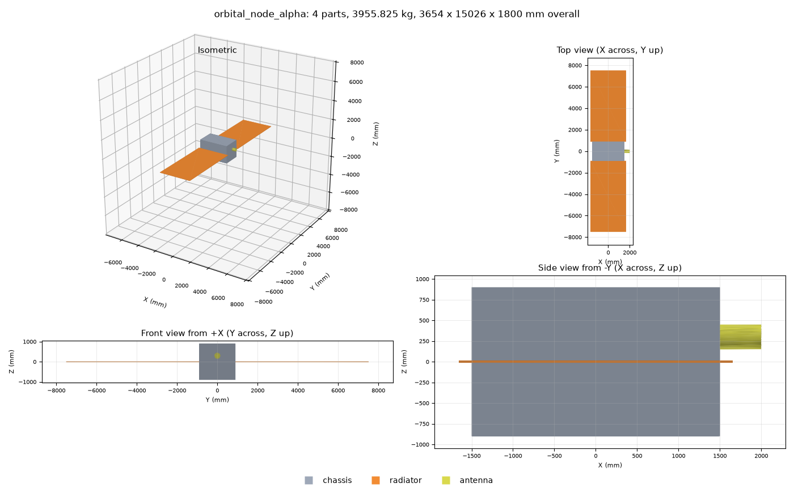
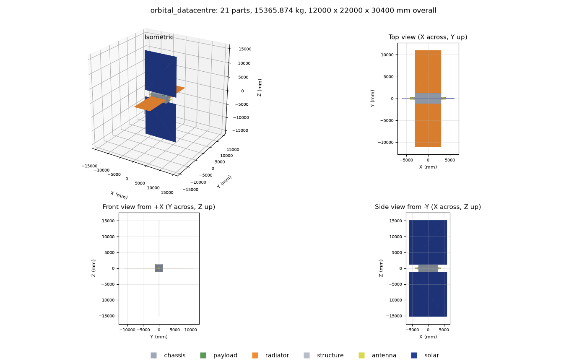
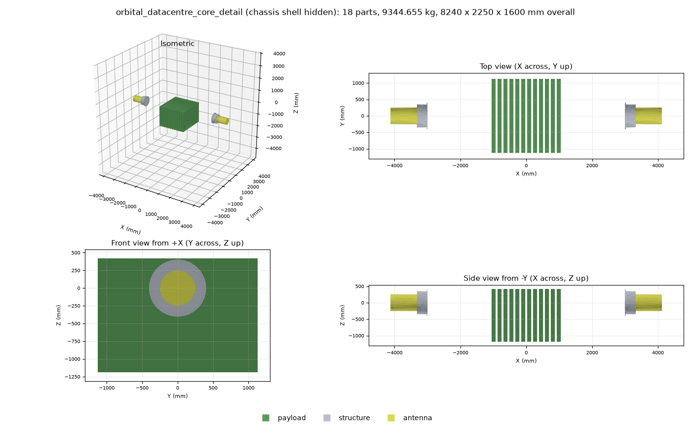

# SatCAD: open-source spacecraft CAD you can talk to

SatCAD lets you describe a spacecraft in plain English and have **Claude** build it as a real 3D model,
draw it, weigh it (including its full **inertia tensor**), check it for mistakes, show it in an interactive 3D viewer,
run a first-order **vibration and stress analysis** on it, and export it as a CAD file. Every dimension can be a named variable or a formula, so changing one number rebuilds the
whole design. You do not need any CAD experience. It can also be used as an ordinary Python library, or through ready-made
example scripts.



*Built entirely by Claude through SatCAD: a 3 m server housing, two radiator wings sized from a 50 kW heat
load, and a laser terminal.*

SatCAD is built on **[build123d](https://github.com/gumyr/build123d)** (a free, open-source CAD library on the
OpenCascade geometry kernel) and talks to Claude through the **Model Context Protocol (MCP)**. It was written
for an orbital AI datacentre project ([Orbital-Datacentre](https://github.com/Saiaarjay09/Orbital-Datacentre))
but works for any simple spacecraft or box-and-panel design. It is an independent project: it is not derived
from, and not affiliated with, Siemens NX. Files it exports (STEP) are a standard format that NX can import.

> **How capable is it, honestly?** SatCAD is a **concept-design and trade-study tool** with an exact solid-modelling
> kernel, parametric feature history, formulas, real mass properties, and verified physics for what it computes. It is **not** a
> replacement for professional CAD plus certified structural, thermal and orbital analysis, and it should not be the sole basis
> for flight hardware. What it does and does not cover, measured line by line against Siemens NX's publicly described
> capabilities, is in **[docs/NX_BENCHMARK.md](docs/NX_BENCHMARK.md)**; the plan to close the gap is in
> **[docs/ROADMAP.md](docs/ROADMAP.md)**.

---

## Contents

1. [What you can do with it](#1-what-you-can-do-with-it)
2. [Install](#2-install)
3. [Use it](#3-use-it), including [building the orbital AI datacentre](#3f-build-the-orbital-ai-datacentre-build_satellitepy)
   [variables and formulas](#3g-variables-and-formulas-nx-style-expressions), and
   [assemblies, hardware and structural analysis](#3h-assemblies-hinges-hardware-and-structural-analysis)
4. [Five ideas that make CAD easy](#4-five-ideas-that-make-cad-easy)
5. [What each file does](#5-what-each-file-does)
6. [Reference: tools Claude can call](#6-reference-tools-claude-can-call)
7. [Reference: part types and their settings](#7-reference-part-types-and-their-settings)
8. [How it works](#8-how-it-works)
9. [Extending it](#9-extending-it)
10. [Testing](#10-testing)
11. [Troubleshooting](#11-troubleshooting)
12. [Limits](#12-limits)

---

## 1. What you can do with it

- **Sketch a spacecraft by talking.** "Make a hollow 3 m server housing and put radiators on both sides."
- **Size the big things from numbers.** Give it a heat load and it works out how much radiator area is
  needed; give it a power budget and it works out the solar array.
- **Change one number and everything follows.** Make the housing wider and the attached radiators move out
  with it. This is what "parametric" means. Dimensions can be **named variables and formulas**
  (`=(wingspan - chassis.width) / 2`), like NX expressions.
- **Model real hardware shapes.** Extruded beams and tubes, revolved propellant tanks and nozzles, swept and bent pipes, lofted
  adapters, hollowed-out (shelled) housings, filleted edges, ISO clearance / tapped / counterbored holes, socket-head screws,
  linear and circular patterns, mirror copies.
- **Organise it like a real product.** Nested **assemblies** with rolled-up mass and inertia, and **hinges** that stow and deploy
  panels (drag a slider in the viewer).
- **Analyse it.** A built-in shell finite-element solver (**BETA**) finds the **vibration modes** (animated in the browser) and
  **stress under g-loads**, with margins of safety.
- **See what you built.** An **interactive 3D viewer** (orbit, zoom, click parts for mass and material, hide parts, explode
  the assembly, centre of mass) plus four-view pictures after every change.
- **Catch mistakes.** Total mass, centre of mass and the **full inertia tensor** (what attitude control needs), overlapping
  parts, parts floating in space, and a bill of materials.
- **Hand it on.** Export **STEP** (opens in most CAD programs, including Siemens NX), **STL** (3D printing,
  mesh viewers) or **GLB** (web and AR viewers).
- **Build the full orbital AI datacentre in one command** (`python build_satellite.py`): chassis with compute
  blades, hinged radiators, bolted laser terminals and hinged solar arrays, all driven by variables at the top of one file.
- **Run trade studies.** Because designs are saved as small JSON recipes, you can version them in git and
  compare variants.

## 2. Install

### What you need

- macOS or Linux (Windows: use WSL, see [Troubleshooting](#11-troubleshooting))
- Python 3.10 or newer (`python3 --version` to check)
- `git`
- About 1 GB of disk space (most of it is the CAD library)
- For the Claude connector: [Claude Code](https://claude.com/claude-code)

### Quick install (recommended)

```bash
git clone git@github.com:Saiaarjay09/Open-source-CAD-software.git
cd Open-source-CAD-software
./setup.sh
```

`setup.sh` does three things: creates a private Python environment in `.venv/`, installs the libraries from
`requirements.txt`, and runs the self-tests. It takes about a minute. It ends with
`272 passed` and the path of the connector.

### Let Claude use it

```bash
./setup.sh --register
```

This does everything above and then registers SatCAD with Claude Code under the name `satellite-cad`.
**Restart Claude Code afterwards.** If the `claude` command isn't available, the script prints the exact entry to
add under `"mcpServers"` in `~/.claude.json`; it looks like this:

```json
"satellite-cad": { "command": "/full/path/to/Open-source-CAD-software/run_server.sh", "args": [] }
```

To check it worked, ask Claude: *"Run design_status on the satellite CAD connector."*

### Manual install (if you prefer to see each step)

```bash
python3 -m venv .venv
source .venv/bin/activate
pip install -r requirements.txt
python -m pytest -q
```

## 3. Use it

### 3a. Talk to Claude (the main way)

Once registered, just describe what you want. A good first conversation:

> Start a new satellite design. Make a hollow aluminium server housing 3 m long, 1.8 m wide and 1.8 m tall
> with 10 mm walls and 3,000 kg of servers inside. Show me a picture.

> I need to reject 50 kW of heat at a radiator temperature of 330 K. Size the radiators and add them to both
> sides of the housing.

> Add a 300 mm diameter laser terminal on the front face. Check for overlaps and tell me the total mass.

> Make the housing 4 m long. What happened to the radiators? Then export it as a STEP file.

Claude explains each step, shows the four-view picture after every change, and saves files under
`cad_output/`. Your design is **autosaved**, so it is still there the next time you start Claude.

Other things to ask for: "How big must the solar array be for 100 kW?", "Tilt the radiators 30 degrees",
"Which material should the panels be, and what does that do to the mass?", "Save this as `baseline`", "Load
`baseline`", "List every part with its mass".

### 3b. Run a ready-made example script

No Claude needed. Open the file, change the numbers in the clearly marked box at the top, and run it:

```bash
source .venv/bin/activate
python examples/hello_satellite.py      # chassis + two radiator panels
python examples/datacentre_v0.py        # sizes radiators and solar wings from a power budget
```

Each prints a summary and writes a picture and CAD files to `examples/output/`.

### 3c. Use it as a Python library

```python
from satcad import Design, size_radiator
from satcad.render import render_png

d = Design("my_sat")
d.add("chassis", "bus", length=3000, width=1800, height=1800, wall=10, internal_mass_kg=3000)

rad = size_radiator(50_000, panel_temp_k=330)            # how much radiator for 50 kW?
d.add("panel", "radiator_left", attach_to="bus", side="+y",
      length=rad["suggested_each_length_mm"], width=rad["suggested_each_width_mm"], thickness=25)

d.edit("bus", width=2200)                                # change a number: the radiator follows
print(d.measure())                                       # mass, centre of mass, overall size
print(d.check())                                         # overlaps and floating parts
open("my_sat.png", "wb").write(render_png(d))
d.export("out", "my_sat")                                # out/my_sat.step, .stl, .glb
d.save("out/my_sat.json")                                # the recipe, reloadable with d.load(...)
```

### 3d. Where your files go

| What | Where |
|---|---|
| Autosave of the current design | `cad_output/designs/current.json` |
| Designs you save by name | `cad_output/designs/<name>.json` |
| Preview pictures | `cad_output/<design name>_preview.png` |
| STEP / STL / GLB exports | `cad_output/exports/` |
| Example script output | `examples/output/` |

Change the output folder with the `SATCAD_OUT` environment variable. All of these are ignored by git.

### 3e. Opening the result in Siemens NX (or another CAD program)

Export a STEP file, then in NX use **File → Import → STEP** (menu wording varies by version). Each part's
name and colour are stored in the file; whether NX shows them depends on its import settings. This path has
not been tested against NX itself (no licence was available). The STEP output *was* verified by re-importing it
into the open-source kernel and checking the volume matches.

### 3f. Build the orbital AI datacentre (`build_satellite.py`)

`build_satellite.py` uses SatCAD to design a complete space-based AI compute node with four subsystems, each its own **assembly**
(39 parts in all):

| # | Subsystem | What it is in the model |
|---|---|---|
| 1 | **Central datacentre chassis** | A large hollow aluminium box (6 x 2.4 x 2.4 m, rounded edges, optical feed-through holes) holding a row of 12 upright **compute blades**, plus the mass of the pumps and coolant |
| 2 | **Thermal radiators** | Two flat panels reaching out of the left and right sides, 22 m tip to tip: about **8 times the chassis's top-down footprint**. Each is on a **hinge**, so it can be stowed against the chassis |
| 3 | **Optical inter-satellite links (OISL)** | Two laser terminals, front and rear. Each is a mounting flange **bolted to the chassis with 8 x M6 socket-head screws into tapped holes**, a gimbal housing (for the Fast Steering Mirror) and a telescope barrel |
| 4 | **Solar arrays** | Two flat wings on the top and bottom faces, in a plane **perpendicular to the radiators**, with their big faces toward the sun. Each is on a **hinge** |





**Run it** (from the repository folder, after `./setup.sh` has been run once):

```bash
source .venv/bin/activate
python build_satellite.py --view
```

Or in one line without activating the environment:

```bash
.venv/bin/python build_satellite.py --view
```

It takes about ten seconds. `--view` opens the **interactive 3D viewer** in your browser when done; leave it off to just write the files.
Add `--no-modes` to skip the vibration analysis.

**What you get**, in `output/orbital_datacentre/`:

| File | What it is |
|---|---|
| `orbital_datacentre_viewer.html` | **Interactive 3D model.** Orbit, zoom, an assembly tree with rolled-up masses, **hinge sliders** (fold and unfold the radiators and solar wings), click parts for mass and material, hide parts (try hiding the chassis to see the blades), explode, centre of mass, save PNG. Needs internet on first open |
| `orbital_datacentre_modes.html` | **Animated vibration mode shapes** of the whole satellite, coloured by displacement, with each mode's frequency and effective mass (BETA analysis, see 3h) |
| `orbital_datacentre.png` | The whole satellite in four views (isometric, top, front, side) |
| `orbital_datacentre_core_detail.png` | A cut-away of the compute blades and laser terminals, with the chassis shell hidden |
| `orbital_datacentre.step` | The 3D model as a CAD file. Import it into Siemens NX, Fusion 360, SolidWorks or FreeCAD |
| `orbital_datacentre.stl` / `.glb` | Mesh versions for 3D-printing slicers and web / AR / mesh viewers |
| `orbital_datacentre.json` | The editable recipe with all its variables and formulas: reload it with `Design().load(...)` or the connector's `load_design`, then use `set_variable` to resize it |
| `orbital_datacentre_bom.csv` | Bill of materials: every part with material, mass, volume and size, and a TOTAL row |
| `orbital_datacentre_report.txt` | The design report (also printed to the screen) |

**Change the size.** Open `build_satellite.py`. The numbers you can change are in one clearly marked block at the
very top. Edit one, save, and run it again. Everything is in millimetres.

| Variable | Default | Meaning |
|---|---|---|
| `CHASSIS_LENGTH` / `_WIDTH` / `_HEIGHT` | 6000 / 2400 / 2400 | Chassis size: front-to-back (X), left-to-right (Y), bottom-to-top (Z) |
| `CHASSIS_WALL` | 15 | Wall thickness of the hollow chassis |
| `CHASSIS_EDGE_RADIUS` | 25 | Rounding of the chassis edges (0 = sharp) |
| `PLUMBING_MASS_KG` | 1500 | Pumps, coolant and pipework inside (counted in mass, not drawn) |
| `BLADE_COUNT`, `BLADE_THICKNESS`, `BLADE_PITCH`, `BLADE_HEIGHT`, `BLADE_SIDE_CLEARANCE` | 12, 120, 180, 1600, 60 | The row of compute blades inside the chassis. Pitch is centre-to-centre spacing |
| `RADIATOR_WINGSPAN` | 22000 | **Tip-to-tip** span across both panels and the chassis |
| `RADIATOR_CHORD` | 6000 | How wide each radiator panel is, along the satellite's length |
| `RADIATOR_THICKNESS` | 40 | Radiator panel thickness |
| `RADIATOR_TILT_DEG` | 0 | Fixed tilt of both panels up (+) or down (-) as a symmetric V |
| `RADIATOR_DEPLOY_ANGLE_DEG` | 0 | **Hinge angle**: 0 = deployed flat, up to 90 = swung up against the chassis |
| `TRANSCEIVER_RADIUS` | 250 | Radius of each laser telescope barrel |
| `TRANSCEIVER_LENGTH` | 800 | Length of each telescope barrel |
| `GIMBAL_RADIUS_FACTOR`, `GIMBAL_LENGTH` | 1.4, 300 | Gimbal housing size, as a multiple of the telescope radius, and its length |
| `OISL_PORT_FACTOR` | 0.8 | Optical feed-through hole cut in the chassis wall under each terminal, as a multiple of the telescope diameter |
| `FLANGE_THICKNESS`, `FLANGE_RADIUS_FACTOR` | 20, 1.15 | Mounting flange thickness, and its outer radius as a multiple of the gimbal radius (the bolts sit in the ring this leaves) |
| `OISL_BOLT_COUNT` | 8 | M6 screws per terminal on a bolt circle (3 to 64, or 0 for none) |
| `SOLAR_WING_LENGTH` / `_WIDTH` / `_THICKNESS` | 14000 / 12000 / 40 | Size of each solar wing |
| `SOLAR_DEPLOY_ANGLE_DEG` | 0 | **Hinge angle** of the solar wings: 0 = deployed, up to 90 = folded over |
| `RADIATOR_TEMP_K`, `RADIATOR_EMISSIVITY`, `SOLAR_CELL_EFFICIENCY`, `SOLAR_PACKING_FACTOR`, `SOLAR_END_OF_LIFE_FACTOR` | 330, 0.85, 0.30, 0.90, 0.85 | Operating assumptions used only for the report, not for the shapes |

**Or change a size without editing the file** with `--set` (repeat it for several), and give the result its own name
so it does not overwrite the first:

```bash
python build_satellite.py --set RADIATOR_WINGSPAN=30000 --set BLADE_COUNT=16 --name wide_radiators
python build_satellite.py --set TRANSCEIVER_RADIUS=400 --set CHASSIS_LENGTH=8000 --name big_optics
```

If a combination can't work (for example more blades than fit, or a wingspan narrower than the chassis), the script
stops with a plain-English message saying what to change.

**Everything is a variable.** Each number in that block is stored in the model as a lower-case named variable
(`radiator_wingspan`, `chassis_length` ...) and the shapes are built from formulas that use them. The right radiator is a true
mirror of the left, the rear laser terminal a mirror of the front, and the compute blades a pattern, so they cannot drift out of
symmetry. After loading the `.json` into the Claude connector, `set_variable("radiator_wingspan", 30000)` rebuilds the
whole satellite.

**Stow and deploy.** The deploy angles move real hinges, and mass properties, overlap checks and the vibration analysis all use the
new pose:

```bash
python build_satellite.py --set RADIATOR_DEPLOY_ANGLE_DEG=90 --name radiators_stowed
python build_satellite.py --set SOLAR_DEPLOY_ANGLE_DEG=90 --name wings_folded
```

Folding the radiators alone, or the solar wings alone, gives a clean design. Folding **both** to 90 degrees makes the top solar wing
lie across the standing left radiator, and the report lists that overlap: the checker is telling you the stowed arrangement needs
more thought (for example folding the wings the other way), exactly as an interference check should.

**Read the design report.** After building, the script prints the total mass, the mass by role and by subsystem, the **centre of mass and
inertia tensor**, the **radiator area
compared with the chassis**, how much heat the radiators can reject at the chosen temperature, how much electrical
power the solar wings make, and a **heat balance**: all electrical power ends up as heat, so the radiators must be
able to reject at least as much as the arrays generate. If they cannot, it prints a warning. If you shrink the radiators
or enlarge the solar wings and see that warning, the design no longer closes thermally. It also lists any overlapping
or floating parts, the screws seated in tapped holes, and the first vibration modes. The radiator and solar numbers are rough
estimates (see [Limits](#12-limits)).

**Link to the optical-link simulator.** `TRANSCEIVER_RADIUS` is the barrel radius; the usable optical aperture is a bit
smaller. It corresponds to the `--tx-aperture-m` / `--rx-aperture-m` settings in the
[Orbital-Datacentre](https://github.com/Saiaarjay09/Orbital-Datacentre) link simulator, so you can size the telescope
here and test its link performance there.

**Use it from your own code:**

```python
import build_satellite
d = build_satellite.build({"RADIATOR_WINGSPAN": 30000})     # any variable can be overridden
text, facts = build_satellite.report(d, {"RADIATOR_WINGSPAN": 30000})
print(facts["heat_rejection_kw"], facts["solar_power_kw"])
```

### 3g. Variables and formulas (NX-style expressions)

Any numeric setting can be a **formula**: text that starts with `=`. Formulas can use **named variables** and can read the size and
position of other parts, so a whole design is driven by a handful of numbers.

```python
from satcad import Design

d = Design("demo")
d.set_variable("bay", 500)                 # a named variable
d.set_variable("wingspan", 20000)
d.add("chassis", "chassis", length="=bay * 4", width=2000, height=1500, wall=10)
d.add("panel", "radiator", attach_to="chassis", side="+y",
      length="=(wingspan - chassis.width) / 2", width=3000, thickness=20)   # reads the chassis's width
d.add("cylinder", "mast", radius=100, height=1000, x="=chassis.xmax + 50")  # sits just in front of the chassis

d.set_variable("wingspan", 30000)          # one number: the radiator grows
d.set_variable("bay", 800)                 # the chassis grows, the radiator and the mast follow
```

With Claude: *"Make a variable called wingspan equal to 22 m. Size the radiators so the tip-to-tip span equals it."*

| You can write | Meaning |
|---|---|
| numbers and `+ - * / // % **` and brackets | arithmetic |
| `bay`, `wingspan` ... | a named variable (create it with `set_variable`; variables can use other variables) |
| `chassis.width`, `chassis.length` ... | a setting of another part |
| `chassis.xmax`, `.xmin`, `.ymax`, `.ymin`, `.zmax`, `.zmin` | where another part's bounding box is |
| `chassis.size_x`, `.size_y`, `.size_z`, `chassis.mass` | its overall size and mass |
| `sqrt()`, `abs()`, `min()`, `max()`, `round()`, `floor()`, `ceil()`, `log()`, `log10()`, `exp()` | maths functions |
| `sin()`, `cos()`, `tan()`, `asin()`, `acos()`, `atan()`, `atan2()` | trigonometry **in degrees** |
| `radians()`, `degrees()`, `pi`, `e` | conversions and constants |

Rules that keep it safe and predictable:

- A formula can only refer to a part that is **defined before** it. Variables can only use other variables.
- Circular definitions (`a = b`, `b = a`) are detected and explained.
- If a change makes the design invalid (for example a negative length), **nothing changes** and you get a plain-English reason.
- Formulas are evaluated by a small safe interpreter: they can never run arbitrary code.
- Formulas are saved in the design file, so a saved design stays parametric when you reload it.

### 3h. Assemblies, hinges, hardware and structural analysis

These are the "detail design" features. They are used by `build_satellite.py` and are also available to Claude as tools (section 6).

**Assemblies and hinges.** `add_assembly` makes a named group. Parts join one with their `assembly` setting; assemblies nest. The viewer
shows the tree with each group's mass, and `list_assemblies` returns mass, centre of mass and principal inertias for every level. Give an
assembly a `joint_axis` (`x`, `y` or `z`), a `pivot_*` point and an `angle_deg` (a number or a formula such as `=solar_deploy_angle_deg`)
and it becomes a hinge: its parts, and anything attached to them, swing about that pin. `angle_min` / `angle_max` limit the range, and
`list_joints` reports each pivot and axis in world space. Place the pin on the face of the panel that it swings toward, otherwise the
folded panel swings through the wall it is hinged to.

**Holes and screws.** `add_hole` takes a size (`M3` to `M12`) and a type (`clearance`, `tapped`, `counterbore`, `countersink`) and looks the
diameters up in standard tables (ISO 273 clearance, tap drills, DIN 974-1 counterbores), with optional grids and bolt circles.
`add_fastener` places an ISO 4762 socket-head screw. Threads are **cosmetic**: a tapped hole is drilled at the tap-drill size and the
screw shank is its nominal size, so the screw overlaps the hole wall slightly. `check_design` recognises that and reports it as *thread
engagement* (expected) rather than an overlap error.

**Other shapes.** `add_shell` hollows a solid and leaves chosen faces open. `add_sweep` pulls a profile along a polyline with tangent-arc
bends (pipes, harnesses). `add_loft` blends between sections (adapters, fairings). `add_fillet_edges` rounds or bevels chosen edge groups.

**Structural analysis (BETA).** `analyze_modal` finds the vibration modes (natural frequencies, effective modal mass, animated shapes
in `<design>_modes.html`). `analyze_static` applies g-loads (and, from Python, pressures) and reports displacement, von Mises stress and the
margin of safety on each plate, plus the support reaction. Supports are set with `fixed_part` and `fixed_side`.

The solver models the structure as **flat shell plates** (membrane plus bending with shear, triangles, with exact ties where parts touch), with
equipment as lumped mass. It has been checked against closed-form results: uniaxial stress, simply-supported and clamped plate
deflection, thick-plate shear, plate natural frequencies (Leissa's tables), the free-plate six rigid-body modes, force equilibrium
(reaction = mass x acceleration) and mass agreement with the CAD model (see `tests/test_fem.py`, `tests/test_fem_design.py`). Its limits
matter, so every result prints them:

- Linear only: no large deflection, buckling, contact, or material yield. A 14 m honeycomb wing under 6 g "deflects" metres in this
  linear model; that is the model telling you the wing cannot take that load unfolded, not a prediction of the shape.
- Flat rectangular plates and the six chassis walls only. Rounded edges are ignored; non-rectangular slabs (a flange ring) become a
  rectangle with reduced density.
- Sandwich and composite panels are idealised as one isotropic material (the caveat is printed).
- Parts must touch the supported structure; loose pieces are reported (and a static solve refuses them).
- For **launch**, analyse the *stowed* design (set the deploy angles) with the adapter fixed. The deployed free-free modes (0.2 to 0.7 Hz
  for the datacentre) describe the satellite in orbit.

Treat the numbers as concept-stage and cross-check any you rely on with a certified solver.

## 4. Five ideas that make CAD easy

1. **Part.** One solid object: the chassis, a radiator panel.
2. **Parametric.** A part is stored as a *recipe* (`length = 800`), not as a frozen shape. Change the number
   and the part, and everything attached to it, rebuilds.
3. **Units.** Everything is in **millimetres** (1000 mm = 1 m) and **kilograms**.
4. **Axes.** **X** is forward, **Y** is left, **Z** is up. A face is named by where it points: `+y` is the left
   side, `-y` the right, `+z` the top, `-z` the bottom, `+x` the front, `-x` the back.
5. **Attach.** A panel is attached to a face of another part. It sticks out of that face and follows the part
   if the part is resized or moved.

```
          +z (top)
            |   +x (front)
            |  /
   +y ------+------ -y
  (left)   /|        (right)
        -x  |
          -z (bottom)
```

## 5. What each file does

```
Open-source-CAD-software/
├── README.md                 this guide
├── setup.sh                  one-time installer: environment + libraries + tests (+ optional Claude registration)
├── build_satellite.py        THE ORBITAL DATACENTRE: builds the whole satellite from variables at its top
├── orbital_datacentre_model.py  same as build_satellite.py under the name used in the original brief (it just runs it)
├── run_server.sh             starts the Claude connector; Claude runs this for you
├── requirements.txt          the Python libraries needed (build123d, mcp, matplotlib, numpy, scipy, pytest)
├── pytest.ini                test settings
├── .gitignore                keeps .venv/, cad_output/ and example output out of git
│
├── satcad/                   the software itself (a Python package)
│   ├── __init__.py           what "from satcad import ..." exposes
│   ├── __main__.py           lets you run the server with: python -m satcad.server
│   ├── engine.py             THE CORE: the parametric design engine (parts, recipes, rebuilding, all feature
│   │                         types, mass properties and inertia, BOM, overlap checks, export, save/load).
│   │                         No Claude code in here.
│   ├── expressions.py        the safe formula interpreter behind variables and "=formulas"
│   ├── viewer.py             writes the interactive 3D viewer (assembly tree, hinge sliders) and the animated mode-shape viewer
│   ├── fem.py                the shell finite-element solver (BETA): modal and static analysis of flat-plate structures
│   ├── hardware.py           ISO metric tables: clearance holes, tap drills, counterbores, socket-head screw dimensions
│   ├── materials.py          materials table (density, stiffness, strength, thermal data, colour, caveats) and role colours
│   ├── thermal.py            size_radiator(): radiator area needed for a heat load
│   ├── power.py              size_solar_array(): solar array area needed for a power load
│   ├── render.py             draws the four-view PNG picture
│   └── server.py             THE CONNECTOR: wraps the engine as 42 MCP tools Claude can call
│
├── examples/
│   ├── hello_satellite.py    chassis + two radiators; the numbers to change are at the top
│   ├── datacentre_v0.py      a 100 kW orbital datacentre sketch sized from its power budget
│   └── avionics_box.py       a machined avionics enclosure: shell, ISO holes, socket-head screws, a bent coolant pipe
│
├── tests/
│   ├── test_engine.py        engine, panels, tilt, file-format tests (checked against hand calculations)
│   ├── test_mass_properties.py  mass, centre of mass and inertia checked against closed-form textbook formulas
│   ├── test_expressions.py   variables and formulas: precedence, degrees, safety, cycles, rollback
│   ├── test_features.py      extrude, revolve, fillet, cutout, pattern, mirror, and a mixed spacecraft bus
│   ├── test_viewer.py        the 3D viewer data and its protection against script injection
│   ├── test_assemblies.py    sub-assemblies, hinges, roll-up mass properties, articulated poses
│   ├── test_detail_features.py  shell, sweep, loft, edge fillets, ISO holes, screws, thread engagement
│   ├── test_materials.py     the materials database
│   ├── test_fem.py           the FE solver against closed-form plate, membrane and vibration solutions
│   ├── test_fem_design.py    CAD design to FE model: ties, supports, mass match, loose parts, reactions
│   ├── test_server.py        launches the real server and talks to it like Claude does
│   └── test_build_satellite.py  checks the satellite: subsystems, hinges and stowing, bolted optics, validation, analysis, command line
│
└── docs/
    ├── NX_BENCHMARK.md                   line-by-line scoreboard against Siemens NX's publicly described capabilities
    ├── ROADMAP.md                        what SatCAD covers today vs professional CAD, and the plan to close the gap
    ├── example_orbital_node.png          the picture at the top of this README
    ├── orbital_datacentre.png            whole-satellite picture used in section 3f
    └── orbital_datacentre_core_detail.png  cut-away picture used in section 3f
```

**Which file do I edit?**

| I want to... | Edit |
|---|---|
| change the orbital datacentre's dimensions | the numbers at the top of `build_satellite.py`, or `--set NAME=VALUE` on the command line |
| change any other satellite's dimensions | nothing: ask Claude, or edit the numbers at the top of an `examples/` script |
| add a material | `satcad/materials.py` |
| add a screw or hole size | `satcad/hardware.py` |
| change the structural solver | `satcad/fem.py` (and add a closed-form check to `tests/test_fem.py`) |
| add a new kind of part (e.g. a truss or a dish) | `satcad/engine.py` (see [Extending it](#9-extending-it)), then `satcad/server.py` |
| change how the picture looks | `satcad/render.py` (PNG) or `satcad/viewer.py` (interactive 3D) |
| add a formula function | `satcad/expressions.py` |
| change what Claude is told about how to behave | `INSTRUCTIONS` at the top of `satcad/server.py` |
| change the radiator or solar maths | `satcad/thermal.py` / `satcad/power.py` |

## 6. Reference: tools Claude can call

All sizes are in **mm**, masses in **kg**. Settings marked `?` are optional.

| Tool | What it does | Settings |
|---|---|---|
| `design_status` | Name, parts, total mass and overall size. Call first. | none |
| `design_new` | Throw the design away and start empty. | `name?` |
| `add_chassis` | The main box (housing / bus), hollow or solid, with equipment mass inside; optional rounded edges. | `name, length, width, height, wall?, internal_mass_kg?, material?, fillet?, chamfer?, x?, y?, z?` |
| `add_radiator_panel` | A flat panel attached to a face of an existing part (radiator, solar wing...). | `name, attach_to, side, length, width, thickness, gap?, offset_along_width?, offset_along_thickness?, tilt_deg?, thin_axis?, material?, role?` |
| `add_radiator_pair` | Two identical panels on opposite sides (`_pos` and `_neg`). | `name_prefix, attach_to, axis, length, width, thickness, gap?, tilt_deg?, material?` |
| `add_box` | A plain block, optionally rotated and with rounded edges. | `name, length, width, height, x?, y?, z?, material?, role?, fillet?, chamfer?, rx?, ry?, rz?` |
| `add_cylinder` | A cylinder (telescope barrel, pipe stub). | `name, radius, height, axis?, x?, y?, z?, material?, role?` |
| `add_sphere` | A sphere. | `name, radius, x?, y?, z?, material?, role?` |
| `add_extrusion` | Push a 2D profile (rectangle, circle, polygon; solid or hollow tube) into a solid: struts, beams, brackets. | `name, profile, depth, width?, height?, radius?, points?, wall?, plane?, both_sides?, taper_deg?, x?, y?, z?, rx?, ry?, rz?, material?, role?` |
| `add_revolve` | Spin a profile around an axis: propellant tanks, nozzles, cones, domes. | `name, points, angle?, axis?, x?, y?, z?, material?, role?` |
| `add_cutout` | Cut a round hole or rectangular pocket into a face. | `name, target, side, shape, width?, height?, diameter?, depth?, offset_u?, offset_v?` |
| `add_pattern` | Repeat a part along a line or around an axis. | `name, source, mode, count, dx?, dy?, dz?, axis?, cx?, cy?, cz?, total_angle?` |
| `add_mirror` | A mirror-image copy of a part across a plane. | `name, source, plane, offset?` |
| `edit_part` | Change settings of a part, cutout, pattern or mirror; everything that depends on it follows. | `name, changes` (a dictionary; values may be formulas) |
| `remove_part` | Delete a part (fails if others depend on it). | `name` |
| `set_variable` | Create or change a named variable or formula; the design rebuilds. | `name, value` |
| `delete_variable` / `list_variables` | Remove a variable (if unused) / list all with current values. | `name` / none |
| `list_features` | The design's recipe in build order, with formulas. | none |
| `list_parts` | Every part: size, position, material, mass, settings. | none |
| `measure_design` | Total mass, centre of mass, **inertia tensor** (kg m²), principal moments and axes, overall size, mass by role. | none |
| `check_design` | Overlapping parts (error) and floating parts (warning). | none |
| `preview` | Isometric / top / front / side picture. | `views?` |
| `open_3d_viewer` | Write and open the interactive 3D viewer. | `open_in_browser?` |
| `size_radiator` | Radiator area for a heat load (Stefan-Boltzmann). | `heat_load_w, panel_temp_k?, emissivity?, sides?, sink_temp_k?, panel_count?, aspect_length_over_width?` |
| `size_solar_array` | Solar-cell area for an electrical load. | `power_w, cell_efficiency?, packing_factor?, end_of_life_factor?, sun_angle_deg?, panel_count?, aspect_length_over_width?` |
| `add_assembly` | A named group of parts. With `joint_axis` it becomes a hinge (stow / deploy). | `name, parent?, x?, y?, z?, rx?, ry?, rz?, joint_axis?, angle_deg?, pivot_x?, pivot_y?, pivot_z?, angle_min?, angle_max?` |
| `list_assemblies` | The product tree with rolled-up mass, centre of mass and principal inertias. | none |
| `list_joints` | Each hinge: world pivot and axis, current angle and range, parts moved. | none |
| `add_shell` | Hollow out a solid, leaving chosen faces open. | `name, target, open_faces, thickness, direction?` |
| `add_sweep` | Pull a circle or rectangle along a path with tangent bends: pipes, harnesses. | `name, path, profile?, radius?, width?, height?, wall?, bend_radius?, x?, y?, z?, material?, role?, assembly?` |
| `add_loft` | Blend between sections (circle or rectangle) at different heights: adapters, fairings. | `name, sections, plane?, x?, y?, z?, material?, role?, assembly?` |
| `add_fillet_edges` | Round or bevel chosen edges of a part (`all`, `parallel:z`, `face:+z`...). | `name, target, edges, radius?, chamfer?` |
| `add_hole` | Standard ISO hole (M3 to M12): clearance, tapped, counterbore or countersink, in grids or bolt circles. | `name, target, side, standard, hole_type?, depth?, offset_u?, offset_v?, count_u?, pitch_u?, count_v?, pitch_v?, circle_count?, circle_diameter?, circle_start_deg?` |
| `add_fastener` | An ISO 4762 socket-head screw. | `name, size, length, axis?, x?, y?, z?, material?, assembly?` |
| `analyze_modal` | **BETA.** Vibration modes with effective modal mass; writes an animated viewer. | `n_modes?, fixed_part?, fixed_side?, constraint?, mesh_size?, show_modes?` |
| `analyze_static` | **BETA.** g-load stress analysis: displacement, von Mises stress, margins of safety, reactions. | `accel_x_g?, accel_y_g?, accel_z_g?, fixed_part?, fixed_side?, constraint?, mesh_size?, safety_factor?` |
| `list_materials` | Materials with density, stiffness, strength, expansion, conductivity, and caveats. | none |
| `export_design` | Write STEP / STL / GLB files. | `basename?, formats?` |
| `export_bom` | Write a bill of materials CSV. | `filename?` |
| `save_design` / `load_design` | Save or reload the editable recipe (with its variables and formulas) by name. | `filename?` / `filename` |

Every number-valued setting accepts a **formula** (text starting with `=`) as well as a plain number.

The server also offers a resource, `satcad://guide`, a plain-English glossary Claude can read.

## 7. Reference: part types and their settings

Every part has these **common settings**:

| Setting | Meaning | Default |
|---|---|---|
| `material` | Name from the materials table. Sets mass. | `aluminum_6061` (panels: `aluminum_honeycomb`) |
| `role` | A label that sets the colour in pictures and groups the mass report (`structure`, `chassis`, `radiator`, `solar`, `payload`, `antenna`). | `structure` (chassis: `chassis`, panels: `radiator`) |
| `color` | Override colour as `[r, g, b]` with values from 0 to 1. Set with `edit_part`. | from role |
| `notes` | Free text. | empty |

Parts that are not attached to something also take a **pose**: `x, y, z` (centre, mm) and `rx, ry, rz`
(rotation about the part's own centre, degrees).

| Type | Settings (default in brackets; no default = required) |
|---|---|
| `chassis` | `length` (X), `width` (Y), `height` (Z), `wall` (0 = solid block, otherwise hollow with this wall thickness; the wall must be under half the smallest dimension), `internal_mass_kg` (0; spread uniformly through the interior for the inertia), `fillet` (0, rounds all edges), `chamfer` (0, bevels all edges; not both) |
| `box` | `length`, `width`, `height`, `fillet` (0), `chamfer` (0) |
| `cylinder` | `radius`, `height`, `axis` (`z`; `x`, `y` also allowed) |
| `sphere` | `radius` |
| `panel` | `attach_to` (name of an existing part), `side` (`+x -x +y -y +z -z`), `length` (how far it sticks out), `width` (along the face), `thickness`, `gap` (0, distance off the face), `offset_span` (0, slide along the width), `offset_thin` (0, slide along the thickness), `thin_axis` (default `z` for side faces, `x` for top/bottom faces), `tilt_deg` (0, hinge about the attached edge, on whichever edge keeps the panel out of the part it is attached to; positive follows the right-hand rule about the width axis) |
| `extrude` | `profile` (`rect`, `circle` or `polygon`), `depth`, then `width` + `height` (rect), `radius` (circle) or `points` (polygon, `[[x, y], ...]`); `wall` (0; positive makes a hollow tube, rect/circle only), `plane` (`xy` extrudes along +z, `yz` along +x, `zx` along +y), `both_sides` (false; true extrudes `depth` in each direction), `taper_deg` (0) |
| `revolve` | `points` (outline as `[[radius, height], ...]`, closed automatically), `angle` (360), `axis` (`z`; `x`, `y` also allowed) |
| `cutout` | `target` (part to cut), `side` (face), `shape` (`circle` or `rect`), `diameter` or `width` + `height`, `depth` (0 = all the way through), `offset_u`, `offset_v` (slide along the face: for an x-face u=y v=z, y-face u=z v=x, z-face u=x v=y). Creates no part of its own; it changes `target` |
| `pattern` | `source`, `mode` (`linear` or `circular`), `count` (2 to 500, including the original), `dx dy dz` (linear spacing), `axis` + `cx cy cz` (circular: axis direction and a point on it), `total_angle` (360). Copies are named `<pattern>_2`, `<pattern>_3`, ... |
| `assembly` | `parent`, a pose (`x y z rx ry rz`), and optional hinge settings `joint_axis`, `angle_deg`, `pivot_x pivot_y pivot_z`, `angle_min`, `angle_max`. Creates no solid; parts join it through their own `assembly` setting |
| `shell` | `target`, `open_faces` (list of `+x -x +y -y +z -z`), `thickness`, `direction` (`inward` or `outward`). Changes `target` |
| `sweep` | `path` (points, mm), `profile` (`circle` or `rect`), `radius` or `width` + `height`, `wall` (0 = solid), `bend_radius` (0 = straight, needed for any bend; must fit the corner) |
| `loft` | `sections` (`[["circle", position, radius], ["rect", position, width, height], ...]`, at least two), `plane` |
| `fillet_edges` | `target`, `edges` (`all`, `parallel:x/y/z`, `face:+x ...`), `radius` or `chamfer`. Changes `target` |
| `hole` | `target`, `side`, `standard` (`M3` ... `M12`), `hole_type` (`clearance`, `tapped`, `counterbore`, `countersink`), `depth` (0 = through), grid (`count_u pitch_u count_v pitch_v`) or bolt circle (`circle_count circle_diameter circle_start_deg`). Changes `target` |
| `fastener` | `size`, `length`, `axis`, a position; material defaults to `stainless_316` |
| `mirror` | `source`, `plane` (`xy` flips Z, `yz` flips X, `zx` flips Y), `offset` (0) |

Cutouts, patterns and mirrors **follow** their target or source: edit the original and they update.

`edit_part` also accepts `offset_along_width` and `offset_along_thickness` as aliases for
`offset_span` and `offset_thin`.

Every part also accepts `assembly` (the group it belongs to).

**Materials** (density kg/m³): `aluminum_6061` 2700, `aluminum_7075` 2810, `aluminum_honeycomb` 100 (a rough *effective* value for a
sandwich panel), `titanium_ti6al4v` 4430, `stainless_316` 8000, `inconel_718` 8190, `invar_36` 8050, `cfrp` 1600 (approximated as
isotropic), `copper` 8960, `generic_equipment` 1500 (mass only, not load-bearing). `list_materials` also gives stiffness, strength,
expansion and conductivity. These are typical room-temperature values, not design allowables.

## 8. How it works

```
 You  ──►  Claude  ──(MCP, over stdin/stdout)──►  server.py  ──►  engine.py  ──►  build123d / OpenCascade
 words      picks a tool                          42 tools        recipes →        solids, booleans,
                                                  + autosave      geometry         STEP/STL/GLB export
                                                       │
                                                       ├──►  render.py → PNG picture back to Claude
                                                       └──►  viewer.py → interactive 3D .html
```

- **Recipes, not shapes.** The engine stores each part as a `Feature` (name, type, settings as typed, possibly `=formulas`).
  After any change it **evaluates every formula and rebuilds every part from its recipe, in order**. Panels and
  formulas look up the *current* geometry of the parts they refer to, which is why they follow it.
- **Failed changes undo themselves.** If an add or edit is invalid, the design is restored to how it was.
- **Hollow chassis.** A chassis with a `wall` is a box minus a slightly smaller box, so volume and mass count
  only the metal. Equipment mass (`internal_mass_kg`) is spread uniformly through the interior. A part sitting inside
  the hollow interior is *not* flagged as an overlap, because equipment inside a housing is normal.
- **Mass properties.** Each part's mass is volume × material density (+ equipment mass). The OpenCascade kernel gives each solid's
  inertia about its own centre; the design's centre of mass and **inertia tensor** are the sums of those, shifted with the
  parallel-axis theorem. Principal moments and axes come from an eigen-decomposition. The tests check this against closed-form
  formulas.
- **Assemblies.** Parts keep their own pose; an assembly adds a placement (and optionally a hinge rotation) on top. Panels attached to a
  hinged part follow it, receiving only the hinge motion. Mass properties roll up through the tree.
- **Structural analysis.** `fem.py` turns the design into flat shell plates (the chassis walls, thin slabs) and lumped masses, joins plates
  that touch with exact constraints, and solves with SciPy sparse linear algebra. See 3h for what it has been verified against.
- **Overlap check** intersects every pair of parts; overlap volume above 1 mm³ is reported. **Floating**
  means no other part within 0.05 mm.
- **Autosave.** After every change the server writes `cad_output/designs/current.json` and reloads it on start.
- **stdout belongs to MCP.** The server never prints to standard output; that channel carries the protocol.

## 9. Extending it

**Add a material:** add a line to `MATERIALS` in `satcad/materials.py` (density in kg/m³, colour, note).

**Add a new part type** (say, a `dish`):

1. In `satcad/engine.py`, add an entry to `SCHEMAS` with the settings and defaults (use `REQ` for required ones).
2. In `Design._build_into`, add a branch that builds the shape for that kind and stores a `Part` (use `_make_part`, and `_orient`
   to apply the pose).
3. Add its validation to `Design._resolve` (settings arrive there already evaluated, so formulas are numbers by then).
4. In `satcad/server.py`, add a tool with `@mcp.tool()` that calls `design.add("dish", name, ...)` and wrap
   the result in `_changed(...)` so it autosaves. Write a clear docstring: Claude reads it to decide when to
   use the tool.
5. Add a test in `tests/test_engine.py` and run `python -m pytest -q`.

## 10. Testing

```bash
source .venv/bin/activate
python -m pytest -q
```

272 tests. They include:

- **Physics checks against textbook formulas**: mass, centre of mass and inertia tensors of boxes, hollow shells, spheres,
  cylinders on all three axes, rotated and offset bodies, the parallel-axis theorem, and equipment mass spread through a cavity.
- **Solver verification**: the FE code against Hooke's law, plate deflection and vibration tables, the six rigid-body modes of a free body, and
  force equilibrium; the satellite's FE mass against its CAD mass.
- Assemblies and hinges, ISO hole and screw dimensions, thread engagement, shell / sweep / loft validation, and the stow-and-deploy poses.
- Volumes of extrudes, tubes, revolves, fillets, holes and pockets; pattern and mirror positions.
- Formulas: precedence, trig in degrees, safe evaluation (formulas can't run code), circular and forward references, rollback.
- Panel placement and tilt on all six faces, parametric rebuilds, error messages, save/load (including older files),
  STEP round-tripping, the Stefan-Boltzmann and solar maths, picture and viewer output (including a script-injection test),
  the orbital datacentre model, and full conversations with the real server over the MCP protocol.

## 11. Troubleshooting

| Problem | Fix |
|---|---|
| `setup.sh: Python 3.10 or newer is required` | Install a newer Python from python.org, then `PYTHON=python3.12 ./setup.sh` |
| Claude doesn't list the tools | Run `./setup.sh --register`, then **fully restart** Claude Code. Check the path in `~/.claude.json` points at `run_server.sh` |
| `ModuleNotFoundError: mcp.server.fastmcp` | The wrong MCP version is installed. `requirements.txt` pins `mcp>=1.9,<2`. Run `.venv/bin/pip install -r requirements.txt` |
| `Permission denied: run_server.sh` | `chmod +x run_server.sh setup.sh` |
| "Can't remove part: others are attached" | Remove the attached panels first, or edit the part instead |
| Picture looks empty or tiny | A very large part (e.g. a huge solar wing) shrinks everything else. Use `preview` with one view, e.g. `["side"]` |
| Windows | `setup.sh` and `run_server.sh` are shell scripts. Use WSL, or follow the manual install and register `.venv\Scripts\python.exe -m satcad.server` yourself. Not tested on Windows |
| The first run is slow | Matplotlib builds a font cache once; later runs are fast |

## 12. Limits

Read **[docs/ROADMAP.md](docs/ROADMAP.md)** for the full capability map and plan. In short:

- **Concept-stage tool.** Good for layout, sizing, mass and inertia budgets, trade studies and driving the design from Claude. Not a
  substitute for professional CAD with certified analysis, and not a sole basis for flight hardware.
- **Geometry:** boxes, cylinders, spheres, hollow shells, flat panels, extrusions, revolves, sweeps, lofts, shells, edge fillets, ISO holes
  and screws, patterns, mirrors. No constraint-based sketcher, free-form surfaces, sheet metal, general assembly mates, STEP import or
  2D drawings yet. Threads are cosmetic.
- **Masses and inertia** are exact for the modelled shapes, but depend on simple material densities and idealised blocks for equipment.
- **`size_radiator` is a lower bound.** It ignores sunlight, Earth heat and albedo, and the temperature drop across the panel and its plumbing.
- **`size_solar_array`** ignores eclipse, batteries and self-shading.
- **Structural analysis is BETA.** Linear, flat-plate shell model only (see 3h). No solids, beams, buckling, contact or yield. There is
  **no thermal-network or orbital analysis**; those are the next priorities.
- **Not NX.** Section [docs/NX_BENCHMARK.md](docs/NX_BENCHMARK.md) lists, capability by capability, how far SatCAD is from Siemens NX.
- **Not tested with Siemens NX** (no licence). STEP files are standard, but import behaviour is up to NX.

## Licence

No licence file has been chosen yet. Until one is added, the default is "all rights reserved". Add a `LICENSE`
(for example MIT or Apache-2.0) before sharing it. Dependencies carry their own licences (build123d,
OpenCascade, the MCP SDK, matplotlib).
