# How to use satCAD

A step-by-step guide to the satCAD desktop app, with pictures. No CAD experience needed. Every picture is a real screenshot of the app, made by
`tools/make_howto_images.py`.

**Contents:** [1 Install and start](#1-install-and-start) · [2 The window](#2-the-window-at-a-glance) · [3 Your first part](#3-your-first-part) ·
[4 Combine and shape](#4-combine-and-shape-parts) · [5 Assemblies](#5-assemblies-and-hinges) · [6 Importing a satellite](#6-importing-a-satellite-the-orbital-node-alpha-example) ·
[7 Motion Studio](#7-motion-studio-making-things-move) · [8 Analysis](#8-structural-analysis-beta) · [9 Saving and exporting](#9-saving-and-exporting) ·
[10 With Claude](#10-using-satcad-with-claude) · [11 Troubleshooting](#11-troubleshooting) · [12 Cheat sheet](#12-cheat-sheet)

---

## 1. Install and start

**Easiest: download the app.** On the project's **Releases** page take the file for your computer:

| Computer | File | Install |
|---|---|---|
| Mac with Apple silicon (M1 or newer) | `satCAD-…-macos-arm64.dmg` | open it and drag **satCAD** onto **Applications** |
| Windows 10 / 11, 64-bit | `satCAD-…-windows-x64-setup.exe` | run the installer |

The apps are not code-signed, so the first time your computer warns you. **Mac:** open **System Settings → Privacy & Security**, scroll down and
press **Open Anyway** next to satCAD (once only). **Windows:** on the blue "Windows protected your PC" screen press **More info → Run anyway**.

**Or run it from the source code** (needs Python 3.10 or newer):

```bash
git clone https://github.com/Saiaarjay09/satCAD.git && cd satCAD
python3 -m venv .venv && source .venv/bin/activate
pip install -r requirements.txt PySide6 vtk
python main.py --demo          # opens the app with a small example part
```

---

## 2. The window at a glance


| # | Area | What it is for |
|---|---|---|
| 1 | **Ribbon** | the buttons, grouped on tabs (Home, Assemblies, Simulate, Motion, View) |
| 2 | **Part Navigator** | the list of everything you have done, in order: `Block(1)`, `Cylinder(2)`, `Unite(3)`, `Edge Blend(4)` ... Click one to select it. The tick box shows or hides a body |
| 3 | **3D viewport** | your part. Click a body to select it (it turns orange) |
| 4 | **Property Editor** | the numbers of whatever is selected (length, width, position ...). **Expressions** tab: your named variables |
| 5 | **Information window** | messages, errors and results, in plain English |

The line at the very bottom tells you what to do next ("Edit values in the Property Editor, or press Delete ...").

### The ribbon tabs

**Home**: file, selection filter, shapes, Boolean operations, detail features, undo/redo.


**Assemblies**: groups of parts, interference check, mass properties.

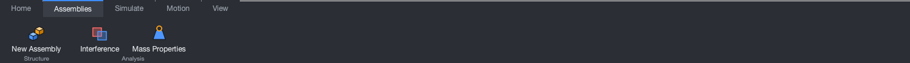

**Simulate**: structural analysis (BETA), motion, reports and **STEP / STL / GLB export**.

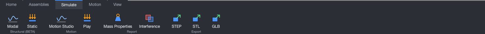

**Motion**: Motion Studio (equations, joints, timeline, presets). See [section 7](#7-motion-studio-making-things-move).

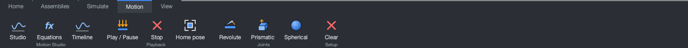

**View**: standard views, zoom to fit, shaded / wireframe.

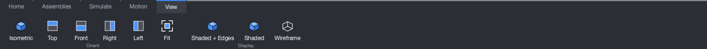

### Moving around in 3D

| To | Do this |
|---|---|
| Select a body | left click it |
| Rotate | **middle-button drag** (or **Alt + left drag** on a trackpad) |
| Pan | **Shift + middle drag** (or **Alt + Shift + left drag**) |
| Zoom | mouse wheel or two-finger scroll, or right-button drag |
| Fit everything | press **F** (or View → Fit) |
| Isometric view | press **Home** |

---

## 3. Your first part

1. Press **Block** on the Home tab. A 100 mm block appears, and `Block(1)` appears in the Part Navigator.

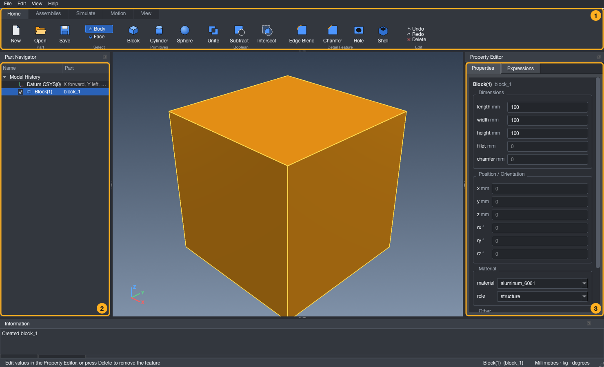

2. With the block selected, the **Property Editor** shows its numbers. Click the **length** box, type `250` and press **Enter**. The block changes at once.
   Everything is in **millimetres**.

3. **Formulas.** Any number can be a formula: type `=` first. Open the **Expressions** tab, type a name such as `wing` and a value such as `300`, press **Add**.
   Back on the Properties tab, set the length to `=wing * 2`. Now changing `wing` changes the block (blue italic text marks a formula).

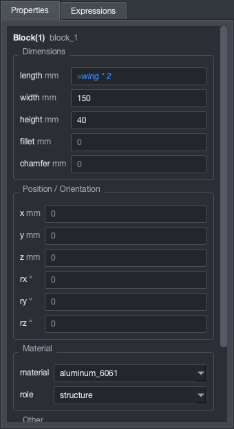 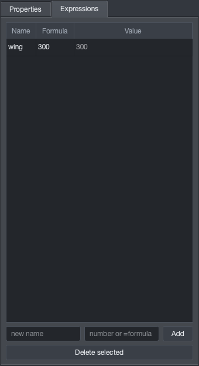

4. Made a mistake? **Ctrl+Z** undoes, **Ctrl+Y** redoes. Errors never break anything: the Information window says what was wrong and the part stays as it was.

5. **Save** (Ctrl+S). Your design goes into the **`sattelite designs`** folder (see [section 9](#9-saving-and-exporting)).

---

## 4. Combine and shape parts

### Boolean operations: Unite, Subtract, Intersect

Make a second body (for example press **Cylinder** and give it a bigger height), then on the Home tab press **Subtract**. Choose the **Target** body (the one you keep)
and the **Tool** body (the one that is cut out of it).

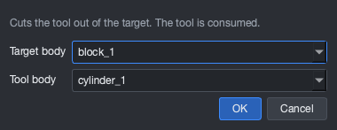

- **Unite** joins two bodies into one (they must touch or overlap).
- **Subtract** cuts the tool out of the target. The tool is used up, as in NX.
- **Intersect** keeps only the volume the two bodies share.

The tree records it as `Subtract(3)`, and the result appears at once:

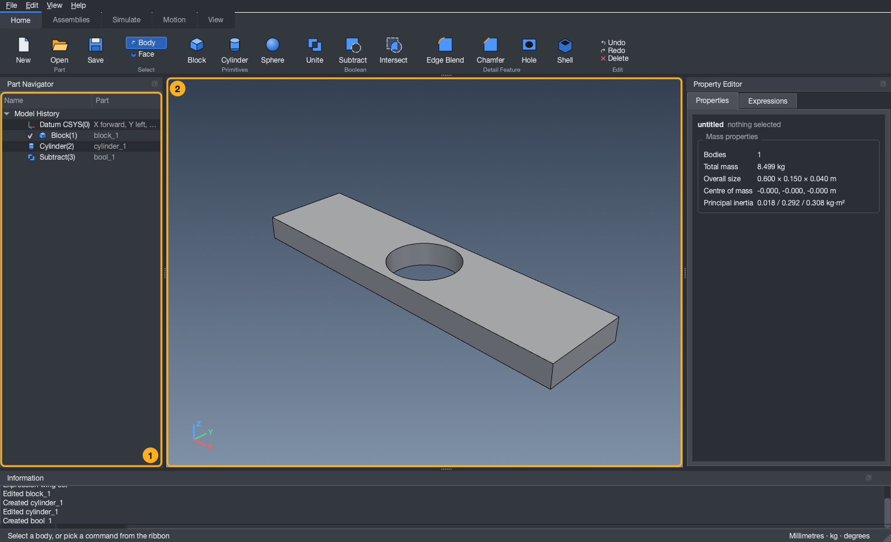

If the bodies do not overlap, satCAD says so and changes nothing.

### Edge Blend, Chamfer, Shell

- **Edge Blend** rounds edges, **Chamfer** bevels them. Choose the body, which edges (`all`, `parallel:z`, `face:+z` ...) and the size.
- **Shell** hollows a body. List the faces to leave open, for example `+z`.

### Holes, and picking a face

1. On the Home tab, in the **Select** group, switch from **Body** to **Face**.
2. Click a flat face in the 3D view. It turns cyan, and the bottom line reports where you clicked.

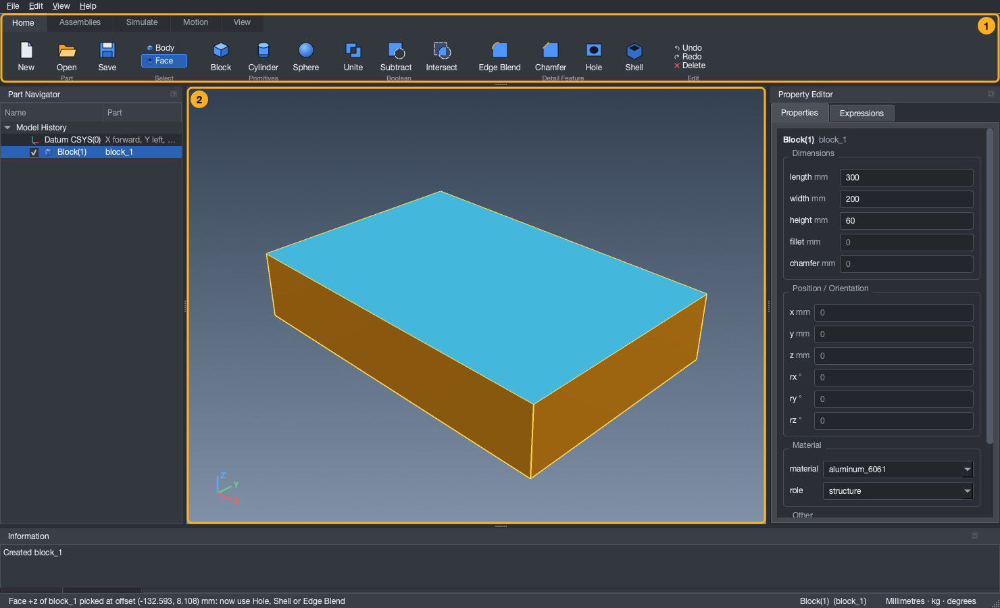

3. Press **Hole**. The dialog is already filled in: the body, the face (`+z`) and the position you clicked. Choose a size (`M3` to `M12`) and a type
   (clearance, tapped, counterbore, countersink); depth `0` means all the way through.

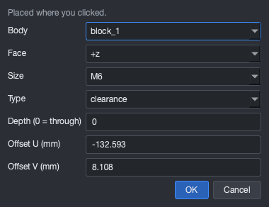

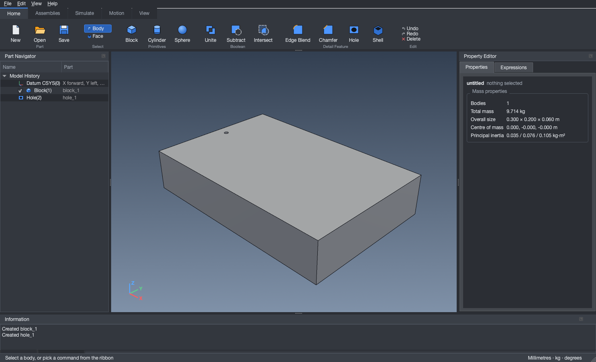

Switch the filter back to **Body** when you have finished picking faces.

---

## 5. Assemblies and hinges

An **assembly** is a named group of parts (the Part Navigator shows it as a folder).

1. **Assemblies → New Assembly.** Give it a name. If you set a **hinge axis**, the whole group can swing about it later.
2. Put a part into the group: select the part, and in the Property Editor set its **assembly** to the group's name.
3. Press **Mass Properties** for the total mass, centre of mass and inertia of everything, and **Interference** to find parts that overlap or float free.

Assemblies can contain other assemblies (an elevation stage inside an azimuth stage), and that nesting is what Motion Studio uses to move things.

---

## 6. Importing a satellite: the Orbital-Node-Alpha example

satCAD **starts empty**: you make what you want, or you import a design. No satellite is built into the app. As an example the project includes a detailed one, **Orbital-Node-Alpha**
(a hollow bus with 16 server blades and copper cold plates, a coolant loop, two radiator wings with micro-tubes, two solar wings and four laser turrets: **405 bodies in 6 sub-assemblies**).
It is an ordinary design file, so you open it like any other:

1. Get the files. In the repository they are in the **`sattelite designs`** folder: `orbital_node_alpha.json` (the geometry) and `orbital_node_alpha_with_motion.json` (the same satellite with its
   Motion Studio setup). If you installed the app, download them from GitHub and put them in `Documents/satCAD/sattelite designs`.
2. **Home → Open** (Ctrl+O). The dialog starts in the designs folder. Choose `orbital_node_alpha.json`.

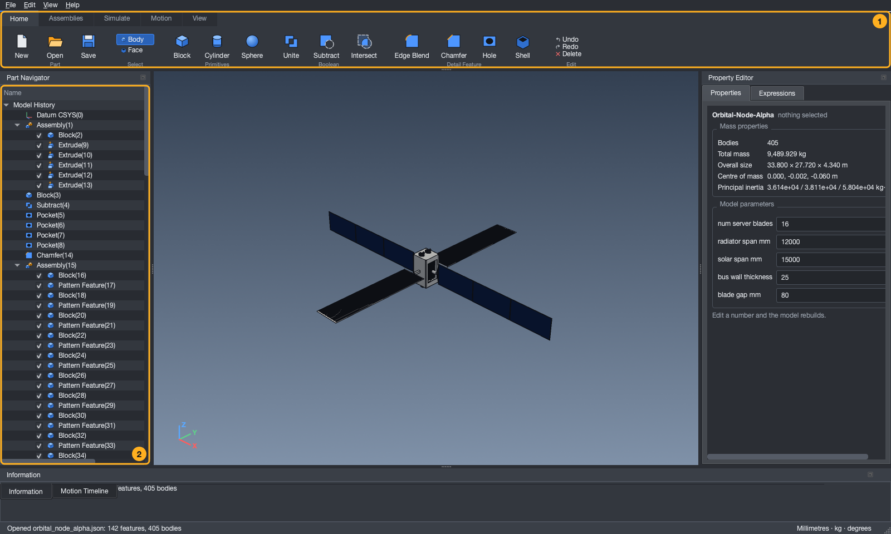

3. In the Part Navigator, **untick the bus hull** (the first body under `Assembly(1)`) to see inside: blades, cold plates, pipes, pumps. Scroll the wheel to zoom in.


4. Click an empty part of the 3D view so nothing is selected: the Property Editor shows the **model parameters**. Change a number and press Enter and the whole satellite rebuilds.

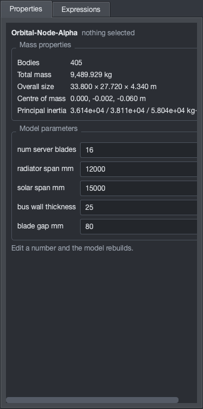

| Parameter | Meaning |
|---|---|
| `NUM SERVER BLADES` | number of server blades (1 to 18) |
| `RADIATOR SPAN MM` | length of each radiator wing |
| `SOLAR SPAN MM` | total span of each solar wing |
| `BUS WALL THICKNESS` | wall of the hollow bus (5 to 60 mm) |
| `BLADE GAP MM` | gap between blades |

Axes: **Z** is the direction of flight, **Y** points away from the Sun (the radiators), **X** points at the Sun (the solar wings).

The file was made by a script, `generate_orbital_node_assembly.py` (run with Python, optional): it shows how to build a large design from code, and you can run it with different numbers
(`--set NUM_SERVER_BLADES=12`) to make your own variant and open that. Your own designs work the same way: save them in the designs folder and open them later.

---

## 7. Motion Studio: making things move

Motion Studio lets you type **formulas of time** (like the graphing calculator Desmos), attach them to parts as **joints**, and play the result in 3D with live graphs.

### 7.1 The quickest start: open the example with motion

1. Open `orbital_node_alpha_with_motion.json` (section 6). Its equations, sliders and joints come with the file.
2. **Motion → Studio** shows the Motion Expressions panel and the timeline.
3. Press **Play** in the timeline, or drag the time slider.


You will see: the **solar wings** turn once per orbit, the **radiator wings** unfold along a smooth S-curve, the **laser turrets** track with a tiny mirror steering inside, and a **colour wave** runs along the coolant pipes.
These mechanisms are ordinary equations and joints: change any of them, or start from an empty part and build your own (sections 7.3 and 7.4).

### 7.2 Equations and sliders

The panel on the right (1) lists the formulas. Time is `t`, in seconds. Angles are in **degrees**.

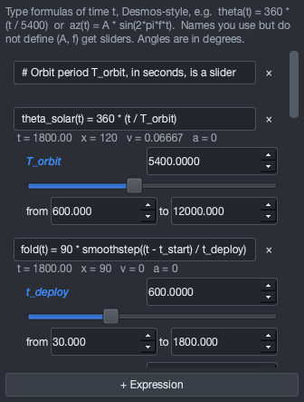

The line under each formula shows its value at the current time, its speed `v` and its acceleration `a`.
**Any name you use but never define becomes a slider** (like `T_orbit` above): drag it, or type an exact value, and the 3D view updates at once. The **from / to** boxes set the slider's ends.

### 7.3 Write your own formula

Press **+ Expression** and type, for example:

```text
my_az(t)   = A * sin(2 * pi * f * t)     a swing of A degrees, f times a second
my_ramp(t) = 10 * t / T_end              a steady turn that reaches 10 degrees at T_end
```

`A`, `f` and `T_end` have never been defined, so three sliders appear:

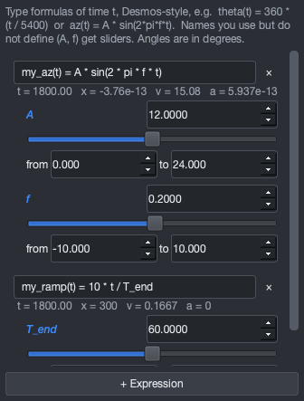

Rules of thumb: use `*` for every multiplication; `^` or `**` for powers; `sin`/`cos` take radians (write `sin(2*pi*f*t)`); names are case-sensitive.
Ready-made helpers: `smoothstep(x)` (an S-curve from 0 to 1), `sigmoid`, `clamp(x, lo, hi)`, `sind`/`cosd` (degrees), `abs`, `min`, `max`, `sqrt`, `exp`, `log`, `pi`, `e`.
A typo is reported under the line (in red) and never stops your other formulas.

### 7.4 Joints: attaching a formula to a part

A **joint** moves one assembly using one formula.

| Joint | Moves it by | Typical use |
|---|---|---|
| **Revolute** | turning about an axis through a pivot | hinges, solar-array drives |
| **Prismatic** | sliding along an axis | extending booms |
| **Spherical** | two turns (pitch and yaw) at a pivot | gimbals, mirrors |

1. Select an assembly in the Part Navigator, then press **Revolute** (or Prismatic / Spherical) on the Motion tab.
2. In the dialog choose the **axis** (for example `1, 0, 0` is the X axis), the **pivot** (a point on the axis; a sensible one is suggested) and the **equation** that drives it.

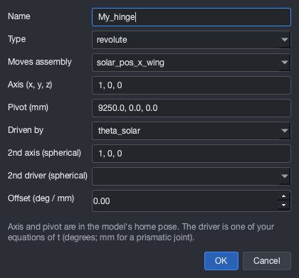

3. The **Joints** tab lists every joint; double-click one to edit it.

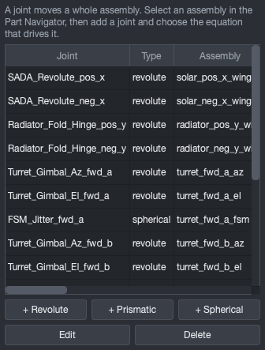

A joint inside a moving assembly rides along with it, so a turret's elevation joint moves with its azimuth joint automatically. Each assembly can have one joint.

### 7.5 The timeline

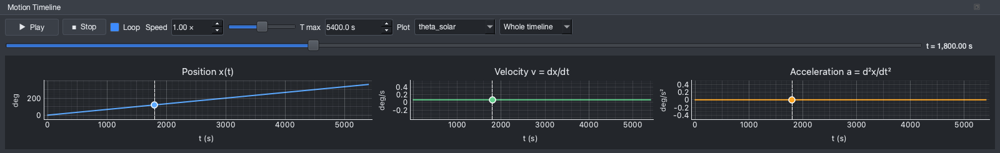

| Control | What it does |
|---|---|
| **Play / Pause**, **Stop** | run the animation, or return to time 0 |
| **Loop** | start again at the end |
| **Speed** (0.1× to 10×) | type a number or use the small slider |
| **T max** | the length of the timeline in seconds |
| time slider | drag to any moment; the 3D view follows |
| **Plot** | choose which formula to graph; three graphs show **position x(t)**, **velocity v** and **acceleration a** |
| dashed cursor | follows the time, and you can **drag it on a graph** to scrub |
| window box | zoom the graphs to ±300 s ... ±2 s around the cursor (useful for fast wobbles) |

While playing, the right-hand corner shows the frame rate.

### 7.6 The Motion tab

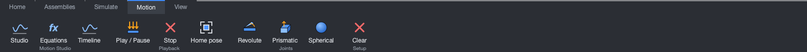

**Studio / Equations / Timeline** show the panels · **Play, Stop, Home pose** (the part as drawn, keeping your setup) · **Revolute, Prismatic, Spherical** add joints ·
**Clear** removes all equations, joints and colour animations.

Your equations, sliders and joints are saved inside the part's file when you press **Save**, and come back when you **Open** it.

---

## 8. Structural analysis (BETA)

**Simulate → Modal** finds how the structure vibrates (natural frequencies, with animated shapes opened in your browser). **Simulate → Static** finds stresses under a load in g.
Choose which body is held fixed (for example the bus, face `-z`). It is a simplified flat-plate model for early design: treat results as estimates, not certification.

---

## 9. Saving and exporting

**Every satellite design lives in one folder: `sattelite designs`.**

- Running from the source code: it is the folder `sattelite designs` at the top of the project.
- Installed app: `Documents/satCAD/sattelite designs` in your home folder.

| You press | You get |
|---|---|
| **Save** (Ctrl+S) | a `.json` file: the editable design, with formulas and motion setup. Open it again with **Open** (Ctrl+O): that is also how you **import** a design someone else made |
| **Simulate → STEP** | a `.step` file for other CAD programs (colours and part names are included) |
| **Simulate → STL / GLB** | a mesh for 3D printing, or for web and AR viewers |

The Open, Save and Export dialogs start in that folder. Command line:

```bash
python generate_orbital_node_assembly.py --step my_alpha.step --json my_alpha.json    # a bare file name goes into the folder
```

satCAD does not import STEP files yet; open `.json` designs.

---

## 10. Using satCAD with Claude

satCAD can also be driven by Claude in plain English ("make a 2 m box with two radiators, then size the radiators for 50 kW"). In a terminal:

```bash
./setup.sh --register
```

then restart Claude Code and ask. Designs it makes are saved in the same `sattelite designs` folder, and you can open them in the app.

---

## 11. Troubleshooting

| Problem | Try this |
|---|---|
| The 3D view is black or empty | the app needs a working OpenGL graphics driver: update your graphics driver, or on a remote or virtual machine use a real desktop session |
| Something is red in the Information window | read it: it says what to change; the part is unchanged |
| "Unknown name" in a formula | the name is not defined; define it, or fix the spelling |
| A joint dialog says the axis is wrong | the axis is three numbers like `0, 0, 1`, and cannot be all zeros |
| Playing is slow on a big model | close the plot panel, or hide parts you do not need (untick them in the Part Navigator) |
| Where is my file? | `sattelite designs` (section 9) |
| Warning on first launch | the app is unsigned; see section 1 |

---

## 12. Cheat sheet

| Keys | |
|---|---|
| Ctrl+N / Ctrl+O / Ctrl+S | new / open / save |
| Ctrl+Z / Ctrl+Y | undo / redo |
| Delete | remove the selected feature |
| F / Home | zoom to fit / isometric view |

Mouse: left click selects · middle drag rotates · Shift + middle drag pans · wheel zooms · right click opens a menu.
